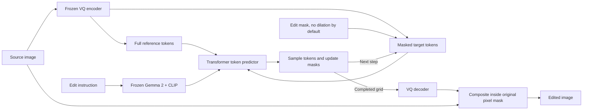

# EditMGT

**Instruction-guided image editing with Masked Generative Transformers.**

[Paper](https://arxiv.org/abs/2512.11715) · [Project page](https://weichow23.github.io/EditMGT/) · [Released weights](https://huggingface.co/WeiChow/EditMGT) · [CrispEdit-2M](https://huggingface.co/datasets/WeiChow/CrispEdit-2M) · [Upstream repository](https://github.com/weichow23/editmgt)

EditMGT edits a source image according to a text instruction. It represents images as discrete visual tokens and repeatedly predicts masked tokens until the edited image is complete. This repository includes the released model, local fine-tuning with **full-reference / sparse-target editing**, optional text/reference caching, and benchmark runners for Inter-Edit and MagicBrush.

- [Model architecture](#model-architecture)
- [Setup and checkpoints](#setup-and-checkpoints)
- [Training data](#training-data)
- [Training](#training)
- [Inference](#inference)
- [Benchmarks](#benchmarks)
- [Script reference](#script-reference)
- [License and citation](#license-and-citation)

## Model architecture

Think of the model as filling in missing pieces of an image while looking at the original image and reading the edit instruction.

1. **Encode the inputs.** A frozen VQ image encoder converts the source into discrete tokens. Frozen Gemma 2 supplies instruction-token features, while CLIP supplies a global text embedding.
2. **Prepare the target.** For mask-guided sparse editing, copy source tokens outside the generation region and mask tokens inside it. By default, the original VQ-grid edit mask defines that region, with no extra dilation. An optional surrounding border, called the **halo**, can be enabled explicitly.
3. **Predict visual tokens.** The Transformer attends to the instruction, the full reference image, and the active target tokens. The sampler keeps confident predictions and leaves uncertain positions masked for later steps.
4. **Decode the result.** Once sampling finishes, the VQ decoder turns the completed token grid back into an image. For mask-guided edit-only inference, composite only the original pixel-mask region onto the source RGB; pixels outside the mask come directly from the source.



The released local configuration in `checkpoint/EditMGT/editmgt/config.json` uses:

| Component | Configuration |
| --- | --- |
| Image tokenizer | VQ encoder/decoder with an 8,192-entry codebook |
| Text conditioning | Gemma 2 token features through a linear connector; pooled CLIP embedding |
| Transformer | 14 multimodal blocks + 28 single-stream blocks |
| Hidden size | 1,024, with 8 attention heads |
| Spatial grids at 1024 × 1024 | 64 × 64 VQ tokens; 32 × 32 Transformer tokens after downsampling |
| Prediction head | Upsampling and a masked-token classifier over the VQ codebook |

### Full reference, sparse target

The **reference branch keeps the entire source image**. Only target cells covered by the edit mask, with an optional halo, pass through the Transformer blocks. Active target features are gathered once before the blocks and scattered back once afterward, before upsampling and token prediction. Original spatial coordinates are retained, with separate position types for text, reference, and target tokens; an additional embedding describes the active region's height and width.

Training defaults to **halo=0: no dilation**. Corruption, masked-token cross-entropy and inference remasking use the original VQ-grid edit mask. The zero-halo path does not downsample and fill the mask back to whole Transformer cells, which would unnecessarily activate neighbouring VQ tokens. Transformer attention still uses OR projection to select cells that contain editable VQ tokens, without a morphological dilation. Source tokens outside the generation mask are copied and receive no loss. Text encoders and the VQ model remain frozen during fine-tuning. All English training launchers inherit the same zero-halo default through `scripts/train_en.sh` and `scripts/train.sh`; `SPARSE_TARGET_HALO` or `--sparse_target_halo` can explicitly re-enable a halo.

The sample inference, validation, pipeline and benchmark defaults all use `sparse_target_halo=0`, including when loading an older checkpoint trained with one or two cells. Passing `sparse_target_halo=None` explicitly to the pipeline/validation helper restores the saved radius for historical reproduction. Changing the halo does not change parameter shapes, so training can resume an older checkpoint with dilation disabled. If a positive halo is explicitly selected, its tokens remain supervised by default; `--no-supervise_target_halo` instead makes it context-only. Without an input mask, inference uses the full target sequence.

The **generation mask** is the original VQ edit mask by default, or an expanded region if a positive supervised halo is explicitly enabled. The **output mask** is the original pixel annotation. Grid discretization still affects generation boundaries even without dilation. `preserve_unmasked_pixels=True` in the pipeline copies source RGB outside the output mask after VQ decoding, including intermediate previews. This is still a hard composition: disabling dilation reduces the generated area but does not itself remove visible seams where generated and source content disagree. The sample inference and benchmark scripts expose `--no-preserve-unmasked-pixels` to inspect raw decoded outputs. `output_type="latent"` returns tokens without pixel compositing. This preservation step does not add a VQ encoding pass or change the reference/text cache policy.

### Optional text/reference KV caching

`scripts/train_en_cache.sh` and its derived launchers train the context branches for reuse during the final, low-noise part of generation. The default transition occurs when the scheduled remaining mask fraction is at most **0.3**:

| Phase | Text and reference branches | Target branch |
| --- | --- | --- |
| High noise | Joint attention with the target | Attends to text, reference, and target |
| Low noise | Attend only to text/reference, with fixed time conditioning | Continues attending to all branches with its current time conditioning |

At inference, the first eligible low-noise forward stores each layer's text/reference keys and values. Later steps process target queries against that cached context. Target keys and values are recomputed, and caches are cleared between generations. Training computes every branch with gradients and never reuses a persistent cache.

Older models support a separate **reference-only snapshot cache**. Because their reference states depend on the evolving target, that cache is an approximation. Joint text/reference caching requires a checkpoint trained with `cache_conditioning` enabled. Use `--disable-condition-kv-cache` to compare recomputation under the same trained attention rules.

Implementation: [model](src/transformer.py), [pipeline](src/pipeline.py), [sampler](src/scheduler.py), [sparse token utilities](src/sparse_utils.py), [KV caches](src/reference_cache.py).

## Setup and checkpoints

Run commands from the repository root. The launchers use Python 3.10 and a repository-local `.venv`. With `uv` installed:

```bash
uv venv .venv --python 3.10
uv pip install --python .venv/bin/python \
  torch==2.11.0 torchvision==0.26.0 \
  --index-url https://download.pytorch.org/whl/cu130
uv pip install --python .venv/bin/python -r requirements.txt
```

This matches the launcher's default CUDA 13.0 package index. Select a suitable PyTorch build for your machine if needed. Automatic setup in `scripts/train.sh` accepts `TORCH_VERSION`, `TORCHVISION_VERSION`, and `PYTORCH_INDEX_URL` overrides. Subsequent training runs can use `SKIP_INSTALL=1`.

Download the released checkpoint into `checkpoint/EditMGT` if it is not already present:

```bash
.venv/bin/python -c 'from huggingface_hub import snapshot_download; snapshot_download("WeiChow/EditMGT", local_dir="checkpoint/EditMGT")'
```

The local training and benchmark workflows need this layout:

```text
checkpoint/EditMGT/
├── editmgt/          # Released editing Transformer
├── text_encoder/     # CLIP text encoder
├── tokenizer/        # CLIP tokenizer
├── llm_encoder/      # Gemma 2 model and tokenizer
├── vqvae/            # Image tokenizer and decoder
└── scheduler/        # Masked-token sampling configuration
```

`src/editmgt.py` assembles these components. Local training loads the `editmgt` subfolder. The original `infer.py` demo defaults to the Hugging Face model ID `WeiChow/EditMGT`; the local inference and benchmark scripts default to `checkpoint/EditMGT`.

## Training data

The current local launchers use **Inter-Edit**, optionally mixed with **MagicBrush**. CrispEdit-2M is linked above as the upstream project's dataset; it is not the default data source of these launchers.

| Dataset / split | Available examples | Use in this repository |
| --- | ---: | --- |
| Inter-Edit train | 1,099,964 pairs | Default training source, all languages |
| Inter-Edit train, English filter | 475,890 pairs | English training launchers |
| Inter-Edit test | 6,250 pairs; 3,413 English | Fixed previews and benchmark evaluation |
| MagicBrush train | 8,807 edit turns in the local release | Optional training mixture |
| MagicBrush dev | 528 edit turns | Held-out single-turn and multi-turn evaluation |
| MagicBrush official test | Separate download | Explicit test benchmark runs |

Counts describe metadata before missing/empty-mask exclusions. Inter-Edit's English training filter keeps instructions containing Latin letters and no Han characters. Test filtering uses official language labels, so an English instruction can still contain literal Chinese text to render. Instructions are not translated during training.

### Inter-Edit layout

The default root is `/mnt/geminihzceph/public/data/Inter-Edit`. Override it with `--instance_data_dir` for training or `--data-dir` for benchmark/analysis scripts.

```text
Inter-Edit/
├── train/
│   ├── manifest.json
│   ├── metadata/train-*.jsonl.gz
│   ├── source_shards/*.tar
│   └── asset_shards/*.tar
└── test/
    ├── metadata.json
    ├── source_images.tar
    ├── target_images.tar
    └── masks.tar
```

[InterEditDataset](src/inter_edit_dataset.py) streams metadata and reads images directly from tar archives. It builds member-offset indexes under `data/inter_edit_tar_index`; no extraction or custom train/test split is required. `--dataset_cache_dir` changes the cache location.

To translate Chinese training instructions into a separate English JSONL with Qwen3.5-9B and vLLM, use [scripts/translate_inter_edit.sh](scripts/translate_inter_edit.sh). It defaults to eight independent GPU replicas and saves each batch for automatic resume; [usage and output format](scripts/README_translate_inter_edit.md) include installation, tensor parallelism, and smoke-test commands.

### MagicBrush layout and mixture

Place the local parquet release under `data/magicbrush`:

```text
data/magicbrush/data/
├── train-*.parquet
└── dev-*.parquet
```

Each row contains `img_id`, `turn_index`, `instruction`, `source_img`, `target_img`, and `mask_img`. [MagicBrushDataset](src/magicbrush_dataset.py) reads bounded PyArrow batches, using each turn's supplied source image, including its edit history. The mixed launcher samples **80% English Inter-Edit / 20% MagicBrush per example**; both streams repeat, and optimizer steps determine run length. Only MagicBrush `train` shards enter training.

All training samples use **white = edit, black = preserve** masks, accepting both 0/1 and 0/255 encodings. Source, target, and mask receive aligned resizing/cropping; crops are adjusted to retain a localized edit. Mask downsampling preserves thin regions. Empty masks are excluded and logged under the dataset cache's `empty_masks/train/` directories; MagicBrush also excludes missing masks. Data is sharded across ranks/workers, while the original dataset files remain unchanged.

The local MagicBrush `mask_img` is an **RGBA source-image cutout**, with transparent pixels marking the edit region. Its RGB values contain scene colors and must not be thresholded as mask labels. Both training and benchmark readers decode the inverted alpha channel into the white=edit convention before resizing or converting to grayscale. L/RGB binary mask exports retain their existing convention. Mask-guided MagicBrush runs record `edit_mask_decoding=magicbrush_alpha_cutout_v1`; use a new output directory for corrected generation, because `--resume` rejects outputs made with the previous decoder. Mask-free vanilla runs do not consume these masks. Checkpoints previously trained on MagicBrush cutouts used the old masks; correcting inference does not undo that training history.

## Training

### Choose a launcher

All shell training launchers live in `scripts/`; the Python implementation and YAML configurations live in `train/`. All variants inherit sparse-target editing, zero halo by default, and the base optimization settings from `scripts/train.sh`.

| Launcher in `scripts/` | Data and additional behavior | Default directory under `runs/` |
| --- | --- | --- |
| `train.sh` | Inter-Edit, all languages | `editmgt_sparse_inter_edit` |
| `train_en.sh` | English Inter-Edit | `editmgt_sparse_inter_edit_en` |
| `train_en_cache.sh` | English Inter-Edit + cache conditioning | `editmgt_sparse_inter_edit_en_cache` |
| `train_en_cache_magicbrush.sh` | English Inter-Edit / MagicBrush mixture + cache conditioning; corrected alpha masks, pure cosine, normalized time, 10% text dropout | `editmgt_sparse_inter_edit_en_cache_magicbrush_maskfix` |
| `train_en_cache_magicbrush_no_dilation.sh` | Corrected alpha masks; fresh initialization from original EditMGT; fixed halo=0 and no halo supervision | `editmgt_sparse_inter_edit_en_cache_magicbrush_no_dilation_maskfix` |
| `train_en_cache_magicbrush_no_dilation_resume.sh` | Corrected alpha masks; initially restore full state from legacy `checkpoint-2600`, then continue latest corrected checkpoint; fixed halo=0 | `editmgt_sparse_inter_edit_en_cache_magicbrush_no_dilation_maskfix` |

For example, train the English/cache-conditioned mixture using an existing environment:

```bash
SKIP_INSTALL=1 REPORT_TO=none \
  bash scripts/train_en_cache_magicbrush.sh \
  --instance_data_dir /path/to/Inter-Edit \
  --max_train_steps 10000
```

The launcher respects `CUDA_VISIBLE_DEVICES` and uses one worker per visible GPU. A single worker runs directly; multiple workers use Accelerate. To select two GPUs explicitly:

```bash
SKIP_INSTALL=1 GPU_IDS=0,1 NUM_PROCESSES=2 REPORT_TO=none \
  bash scripts/train_en_cache_magicbrush.sh
```

### Fresh no-dilation experiment

Start a separate experiment from the original local EditMGT pretrained weights, with a new optimizer, scheduler state and global step 0:

```bash
SKIP_INSTALL=1 bash scripts/train_en_cache_magicbrush_no_dilation.sh
```

This starts fresh fine-tuning of `checkpoint/EditMGT/editmgt`, rather than random initialization of all weights. It keeps the English Inter-Edit / MagicBrush training mixture, cosine sampling, normalized mask-ratio time conditioning, 10% text dropout, complete reference and low-noise text/reference cache policy. Both training and validation fix `sparse_target_halo=0` and disable halo supervision. Corruption, loss and inference remasking use the original VQ edit mask; active Transformer cells still cover their underlying editable tokens without morphological dilation. Pixel output remains composited inside the original annotation mask.

The output directory defaults to `runs/editmgt_sparse_inter_edit_en_cache_magicbrush_no_dilation_maskfix`, separate from the older run trained with incorrectly decoded MagicBrush masks. `--fresh_start` overrides the inherited automatic resume and saves the initialization source and `edit_mask_decoding=magicbrush_alpha_cutout_v1` in `run_initialization.json`. It refuses a directory containing prior output files, so an existing experiment is preserved. For another fresh experiment, set a new `TRAIN_OUTPUT_DIR`. Ordinary optimization options such as learning rate and batch size remain configurable; the profile appends its zero-halo and fresh-start settings after user arguments so those cannot accidentally be overridden.

After training has saved a checkpoint, reproduce its own English validation cases with:

```bash
bash scripts/infer_inter_edit_no_dilation.sh
```

This selects the highest `checkpoint-N` in the corrected-mask run directory, loads that run's `validation/samples.json`, and uses halo=0. Use `--run-dir /path/to/new-run` for another run or `--checkpoint /path/to/checkpoint-N` for a specific saved step. The entry accepts only zero-halo checkpoints with halo supervision disabled and does not fall back to an older experiment. Outputs default to `outputs/inter_edit_no_dilation_maskfix`. The general benchmark scripts already default to halo=0 and can evaluate these checkpoints normally.

To resume this experiment later, use the general mixed launcher with the same `TRAIN_OUTPUT_DIR` and `--no-supervise_target_halo --resume_from_checkpoint latest`; omit `--fresh_start`. The dedicated fresh launcher always starts a new experiment.

To continue the existing `runs/editmgt_sparse_inter_edit_en_cache_magicbrush_no_dilation/checkpoint-2600` with corrected masks:

```bash
SKIP_INSTALL=1 bash scripts/train_en_cache_magicbrush_no_dilation_resume.sh
```

This restores model, optimizer, scheduler and available RNG state at global step 2600, then saves into the separate `_maskfix` run directory above. It retains the previous checkpoint's training history and uses corrected MagicBrush masks for subsequent batches. `run_initialization.json` records the source checkpoint and starting step. Later invocations prefer the latest checkpoint in the corrected run; set `RESUME_FROM_CHECKPOINT=/path/to/checkpoint-N` to select another source explicitly. `--max_train_steps` is the absolute stopping step, including the restored 2600 steps. The preview launcher above follows this same corrected run directory.

### Main settings

Settings come from the shell launchers and `train/train.py` arguments. `train/train_edit.yaml` belongs to the legacy parquet reader and does not configure the default Inter-Edit run. Extra CLI arguments appended to a launcher override its earlier values.

| Setting | Launcher default | Override |
| --- | --- | --- |
| Base model | `./checkpoint/EditMGT`, subfolder `editmgt` | `--pretrained_model_name_or_path`, `--transformer_subfolder` |
| Resolution / precision | 1024 / FP32 | `--resolution`, `--mixed_precision` |
| Batch per GPU / accumulation | 4 / 8 | `--train_batch_size`, `--gradient_accumulation_steps` |
| Learning rate / schedule | `1e-4` / constant | `--learning_rate`, `--lr_scheduler` |
| Optimizer | 8-bit AdamW | `USE_8BIT_ADAM=0` for PyTorch AdamW |
| Gradient clipping | 10 | `--max_grad_norm` |
| Training length | 500,000 optimizer steps | `--max_train_steps` |
| Checkpoint / preview interval | 200 / 200 steps | `--checkpointing_steps`, `--validation_steps` |
| Halo / cache transition | 0 cells, no dilation / 0.3 mask fraction | `SPARSE_TARGET_HALO`, `CONDITION_CACHE_THRESHOLD` |
| Text condition dropout | 0.1 in MagicBrush mixed launchers; 0 in other launchers | `COND_DROPOUT_PROB`, `--cond_dropout_prob` |
| MagicBrush probability | 0.2, in mixed launchers | `MAGICBRUSH_PROBABILITY` |
| Output directory | Per-launcher directory above | `TRAIN_OUTPUT_DIR` |
| Resume | Latest checkpoint in that output directory | `--resume_from_checkpoint` |
| Execution | Eager; compilation disabled | `COMPILE_MODEL=1`, optional `COMPILE_BACKEND` |

Effective global batch size is `batch_per_gpu × number_of_GPUs × accumulation_steps` (32 × the GPU count by default). Keep optimizer type and saved sampling/time settings consistent when resuming. Use separate output directories for architecture or training-recipe changes.

For LoRA and gradient checkpointing:

```bash
SKIP_INSTALL=1 REPORT_TO=none TRAIN_OUTPUT_DIR=./runs/editmgt_en_cache_lora \
  bash scripts/train_en_cache.sh \
  --use_lora --lora_r 32 --lora_alpha 128 --gradient_checkpointing
```

`REPORT_TO=none` disables external tracking; `WANDB_MODE=offline` keeps W&B logs locally. Online W&B logging uses the authenticated account's default entity, with optional `WANDB_ENTITY` and `WANDB_PROJECT` overrides.

### Mask-ratio sampling

Let `r` be the fraction of generation-region tokens to mask: `0` is clean and `1` is fully masked. `train.sh`, `train_en.sh` and `train_en_cache.sh` retain the legacy defaults: `r = cos(pi*u/2)` with uniform `u`, legacy time conditioning, and cross-entropy averaged over supervised tokens.

All training launchers use **100% cosine sampling**, with no shift, lognormal draws or mixture components. The shared launcher fixes this recipe, and the sampler rejects other modes. Training draws a uniform progress value `u` and maps it to `r = cos(pi*u/2)`; validation and inference evaluate the same curve at fixed progress values `i/N`.

`train_en_cache_magicbrush.sh` uses normalized `TIME_CONDITIONING=mask_ratio` and `MASK_LOSS_REDUCTION=sample`. Text condition dropout is 0.1: one shared decision replaces both Gemma sequence features and pooled CLIP features with their empty-prompt features. Source/reference conditioning is retained. Validation defaults to an empty negative prompt and preserves RGB outside the original edit mask. With the default zero halo, loss is restricted to masked tokens in the original VQ edit region.

The historical lognormal launcher is no longer included. Use `scripts/train_en_cache_magicbrush.sh` for cosine sampling. Historical checkpoint directories can be explicitly selected for resume or inference.

`timestep_sampling_config.json` records the effective cosine recipe. Resuming a historical lognormal, shifted or mixed-noise checkpoint automatically continues with cosine and records the old/new recipes in `sampler_transition.json`; its model, optimizer and step are restored. Saved time conditioning and loss reduction must still match. For a historical normalized-time checkpoint, use `bash scripts/train_en_cache_magicbrush.sh --resume_from_checkpoint /path/to/checkpoint-N`. A separate output directory retains the old experiment's reports. The old `--allow_sampler_change_on_resume` flag remains accepted for command compatibility and is no longer required.

### Checkpoints and previews

A full training run produces:

```text
<run-dir>/
├── checkpoint-N/
│   ├── transformer/                 # Model config and weights
│   ├── timestep_sampling_config.json
│   └── ...                          # Optimizer, scheduler, and RNG state
├── validation/
│   ├── samples.json                 # Fixed test cases and prompts
│   ├── selection.json               # Selected official test indices
│   ├── inputs/                      # Exported source, mask, and GT images
│   ├── index.html
│   └── step_NNNNNN/                 # Comparisons, contact sheet, metadata
├── data_mixture/rank_XXXX.json       # Mixed runs: counts and probabilities
└── timestep_sampling_config.json
```

The final Transformer is also saved at the run root. LoRA runs save adapter weights/configuration plus sparse, cache, and time-conditioning metadata instead of a full Transformer.

Five fixed Inter-Edit test cases are previewed at startup, every 200 steps, and at the final step, using seed `42 + sample_id`. English launchers select original English test cases across edit types. Ground truth is used for display. Adjust with `--validation_num_images`, `--validation_sample_indices`, or `--validation_steps`; previews are qualitative checks, not full benchmark scores.

Preview contact sheets and HTML reports show the original output mask in red and the actual token generation mask in orange. Halo is disabled by default; remaining differences between the overlays come from pixel/VQ discretization. Each sample directory also saves `generation_mask.png` and `generation_mask_overlay.png`. Metadata records the actual halo, generation-mask coverage and output-compositing policy.

## Inference

### Released model demo

```bash
.venv/bin/python infer.py
```

This edits `assets/case_5.jpg` with the instruction “Make it into Ghibli style” and saves `outputs/edited_case_5.png`. The demo uses 36 sampling steps, guidance scale 6, and reference strength 1.1.

### Inspect a trained sparse checkpoint

The preview script expects a full training checkpoint containing `transformer/` and an exported validation manifest:

```bash
bash scripts/infer_inter_edit_sparse.sh \
  --checkpoint runs/editmgt_sparse_inter_edit_en_cache/checkpoint-1000 \
  --samples-manifest runs/editmgt_sparse_inter_edit_en_cache/validation/samples.json \
  --output-dir outputs/sparse_checkpoint_1000
```

It reuses source images, prompts, and annotation masks from validation; defaults are 18 steps, guidance 6, reference strength 1.0, and FP32. Halo and cache behavior follow the checkpoint. `--disable-reference-kv-cache` disables reuse; `--disable-condition-kv-cache` specifically disables the joint cache.

For the released model on the same cases:

```bash
bash scripts/infer_inter_edit_vanilla.sh \
  --samples-manifest runs/editmgt_sparse_inter_edit_en_cache/validation/samples.json \
  --num-inference-steps 18 --reference-strength 1.0 \
  --output-dir outputs/vanilla_same_cases
```

This vanilla preview uses source images and instructions without masks or KV reuse. Its default is 36 steps and reference strength 1.1; the command above aligns those settings with the sparse preview. For benchmark comparisons with a shared mask/cache protocol, use the benchmark runners' `--vanilla` option.

### Cosine inference schedule

Training previews, sparse inference, vanilla inference and both benchmark runners use the same unshifted cosine mask schedule, `r_i = cos(pi*i/(2*N))`. There are `N` model forwards and a final clean state `r_N=0`. Model noise conditioning, remasking and cache capture use this cosine schedule. Older scheduler configs are normalized to cosine when generation starts.

`--inference-shift 1` remains accepted for existing commands; other values are rejected. Shift environment variables no longer affect training or inference. In `mask_ratio` mode, the model embeds `1000*r_i`; legacy checkpoints retain their original step-ID time units for weight compatibility.

## Benchmarks

The standalone runners generate edited images and compute objective metrics. They accept full training checkpoints, final Transformer directories, and LoRA checkpoints through `--checkpoint`. Use `--vanilla` for the released editing Transformer. Common generation defaults are **1024 resolution, 18 steps, guidance 6, reference strength 1.0, seed 42, and provided annotation masks**.

The Python benchmark entries live under `eval/`. The four `scripts/benchmark_*.sh` launchers change to the project root and invoke `python -m eval.benchmark_*`, so they also work when called by absolute path from another directory. Direct Python commands should use the same module form from the project root, for example `python -m eval.benchmark_magicbrush --help`.

### Original EditMGT without masks

Two dedicated entry points evaluate the original dense EditMGT using only source RGB and the edit instruction. They load `checkpoint/EditMGT/editmgt` through the local base model, with no fine-tuned `--checkpoint`, sparse target, token-type RoPE, KV reuse or pixel compositing. Generation does not read annotation masks. Inter-Edit's regional metrics read the annotation masks only during scoring; MagicBrush's default metrics require no masks.

```bash
# MagicBrush: 8 GPUs, local dev split, independent and continuous editing.
bash scripts/benchmark_magicbrush_vanilla.sh \
  --data-dir data/magicbrush --split dev --mode both \
  --output-dir outputs/benchmark_magicbrush_dev_vanilla

# Inter-Edit: official English test subset; the mask is for metrics only.
bash scripts/benchmark_inter_edit_vanilla.sh \
  --language en \
  --alpha-clip-ckpt /path/to/clip_l14_grit1m_fultune_8xe.pth \
  --output-dir outputs/benchmark_inter_edit_vanilla
```

Defaults follow the original `infer.py` sampling settings: **36 steps, guidance 6, reference strength 1.1, FP32**, and the original negative prompt from `src/v2_model.py`. All time schedules use cosine. To match the sparse benchmark's sampling settings, pass `--num-inference-steps 18 --reference-strength 1.0 --negative-prompt ""`. `--model-path` may select another original EditMGT base directory containing `editmgt`, `vqvae` and the frozen encoders. Mask-guided or trained sparse models belong in the general benchmark runners; the native entries reject those settings.

These entries use the same datasets, selection, seed derivation, metric implementations, timing scope and output layout as the sparse benchmarks. MagicBrush defaults to L1, L2, CLIP-I and DINO, with separate single-turn/all-turn and multi-turn/final-turn scores. Inter-Edit defaults to LPIPS, AlphaCLIP inside/outside and the boundary metric. `--metrics lpips,boundary` selects an explicit subset when AlphaCLIP weights are unavailable. Generated PNGs are under `images/`, per-image records under `records/`, and scores under `metrics/per_sample.jsonl` and `metrics/summary.json`. `--resume`, `--limit`, `--stage generate` and `--stage metrics` work as in the general runners.

Both MagicBrush shell launchers default to **8 GPU data parallelism**. Each worker loads a full model on one visible GPU and processes different complete editing sessions. All turns and independent/continuous variants of a session stay on the same GPU, preserving multi-turn dependencies. Tasks are assigned by session size without duplicating or padding samples; fewer selected sessions launch fewer workers. Sampling settings and per-sample seeds are unchanged.

```bash
CUDA_VISIBLE_DEVICES=0,1,2,3,4,5,6,7 \
  bash scripts/benchmark_magicbrush_vanilla.sh

# Select another worker count, including the original single-GPU path.
NUM_GPUS=1 bash scripts/benchmark_magicbrush_vanilla.sh
# Or set the worker count on the command line:
bash scripts/benchmark_magicbrush_vanilla.sh --num-gpus 4
```

The launchers use the existing `PYTHON_BIN` / `.venv` environment and spawn local Python workers; no separate `torchrun` command is needed. Direct Python entry points default to one GPU and accept `--num-gpus 8`. `--device cuda:N` selects the first of consecutive visible devices; CUDA metric devices follow the same rule, while `--metric-device cpu` scores on CPU.

`--stage all` finishes every generation worker before launching parallel metric workers. Metric-model initialization is serialized to protect shared weight downloads; scoring then runs concurrently. The parent retains the output lock, merges per-image scores into the existing global summaries, and records worker details under `parallel_execution.json` and `workers/<launch-id>/rank-*/`. GPU count can change on `--resume` when generation settings and selection are otherwise identical.

### Metric dependencies

```bash
uv pip install --python .venv/bin/python -r requirements-benchmark.txt
```

Inter-Edit's regional metrics additionally require [AlphaCLIP](https://github.com/SunzeY/AlphaCLIP), its dependencies, and matching visual weights, supplied with `--alpha-clip-ckpt`. LPIPS, CLIP, and DINO can download weights on first use. `--model-cache-dir` selects the model cache; offline DINO scoring accepts `--dino-repo` and `--dino-weights`.

DINO loading skips Torch Hub's GitHub branch/tag API validation for the fixed `facebookresearch/dino:main` repository, avoiding API rate-limit errors and the resulting `KeyError: 'Authorization'` in affected Torch versions. The initial repository and weight downloads still require network access unless cached or supplied locally. If generation has finished and metric loading fails, rerun with `--stage metrics --output-dir <existing-output-dir>` to score the saved images without loading EditMGT or generating them again.

### Inter-Edit test

```bash
bash scripts/benchmark_inter_edit.sh \
  --checkpoint runs/editmgt_sparse_inter_edit_en_cache/checkpoint-1000 \
  --data-dir /path/to/Inter-Edit \
  --language en \
  --alpha-clip-ckpt /path/to/clip_l14_grit1m_fultune_8xe.pth \
  --output-dir outputs/benchmark_inter_edit_en
```

`--language en` evaluates all 3,413 English test examples; `--language all` evaluates all 6,250. `--limit N` or `--sample-indices ...` selects a recorded subset. Original test IDs and prompts are retained.

Metrics follow the protocol implemented in [src/benchmark_metrics.py](src/benchmark_metrics.py), based on the [Inter-Edit objective evaluator](https://github.com/Delong-liu-bupt/Inter-Edit/blob/main/evaluation/objective_metrics.py):

| Saved metric | Comparison | Better |
| --- | --- | --- |
| `S_global_LPIPS` | Generated vs. GT image, AlexNet LPIPS | Lower |
| `S_in_AlphaCLIP` | Generated vs. GT inside the edit mask | Higher |
| `S_out_AlphaCLIP` | Generated vs. source outside the edit mask | Higher |
| `BSS_Laplacian` | Difference in mean Sobel gradient magnitudes across boundary rings | Lower |

The boundary metric retains the upstream key despite using Sobel gradients. Regional scoring always uses the **original annotation mask**, independently of generation halo. Images are aligned to native source size unless `--metric-resolution` is set. Reference-object scoring is unavailable when the dataset supplies no separate reference-object image. `--metrics lpips,boundary` runs a declared subset without AlphaCLIP.

### MagicBrush dev and official test

The default evaluates the held-out local **dev split**, with independent and continuous editing:

```bash
bash scripts/benchmark_magicbrush.sh \
  --checkpoint runs/editmgt_sparse_inter_edit_en_cache/checkpoint-1000 \
  --split dev --mode both \
  --output-dir outputs/benchmark_magicbrush_dev
```

- **Single-turn:** every turn starts from its provided source image.
- **Multi-turn:** the first turn starts from its source; later turns use the preceding generated result. The main score uses the final output of each session.

Default metrics are `l1,l2,clip-i,dino`. These need no caption file. To evaluate the separately distributed [official test release](https://github.com/OSU-NLP-Group/MagicBrush#dataset-access), extract its `edit_sessions.json` and `images/<image_id>/` folders, then run:

```bash
bash scripts/benchmark_magicbrush.sh \
  --checkpoint runs/editmgt_sparse_inter_edit_en_cache/checkpoint-1000 \
  --data-dir /path/to/magicbrush_test --split test --mode both \
  --caption-file /path/to/global_description.json \
  --metrics l1,l2,clip-i,dino,clip-t \
  --output-dir outputs/benchmark_magicbrush_test
```

The reader also accepts split-specific parquet files and flat JSON/JSONL manifests through `--manifest`. Metrics follow the [MagicBrush image evaluator](https://github.com/OSU-NLP-Group/MagicBrush/blob/main/evaluation/image_eval.py):

| Metric | Definition | Better |
| --- | --- | --- |
| `l1` | Mean absolute RGB error in [0, 1] | Lower |
| `l2` | Mean squared RGB error | Lower |
| `clip-i` | Generated/GT cosine similarity, CLIP ViT-B/32 | Higher |
| `dino` | Generated/GT cosine similarity, DINO v1 ViT-S/16 | Higher |
| `clip-t` | Generated image vs. target global caption, CLIP | Higher |
| `clip-t-oracle` | GT image vs. the same caption; reported with CLIP-T | Higher |

CLIP-T requires **target global descriptions**, not edit instructions. Summaries keep `single_turn_all` and `multi_turn_final` separate; `multi_turn_all_diagnostic` is an additional diagnostic. Dev and test results retain their split labels.

### Outputs, resume, and scoring saved images

```text
<output-dir>/
├── run.json                    # Checkpoint identity, dataset scope, generation settings
├── selection.json              # IDs, prompts, asset locators, evaluation groups
├── execution.json              # Hardware, precision, loaded model policy
├── generation_summary.json     # Completion counts and timing
├── images/                     # Generated PNGs
├── records/                    # Per-image seeds, timing, memory, cache details
└── metrics/
    ├── per_sample.jsonl
    ├── summary.json            # Aggregate scores, counts, and breakdowns
    └── errors.jsonl
```

Use `--resume` with identical checkpoint/settings/selection to continue an interrupted run. Use a new output directory for changed settings. Generation and scoring can run separately:

```bash
bash scripts/benchmark_inter_edit.sh \
  --checkpoint runs/editmgt_sparse_inter_edit_en_cache/checkpoint-1000 \
  --stage generate --language en --output-dir outputs/inter_edit_run

bash scripts/benchmark_inter_edit.sh \
  --stage metrics --output-dir outputs/inter_edit_run \
  --alpha-clip-ckpt /path/to/clip_l14_grit1m_fultune_8xe.pth
```

Metrics-only mode reads the saved run without loading EditMGT; original dataset assets must remain accessible. `--stage all` releases the editing model before loading metric models. Timing includes prompt/VQ encoding, token sampling, and decoding, with one unmeasured warmup by default; disk I/O and scoring are excluded. Reports include peak GPU memory and cache reuse details.

For comparable results, match checkpoint, split/subset, mask protocol, halo, pixel-compositing policy, steps, guidance, precision, cache policy, and metric set. Every runner uses cosine scheduling. The default `--mask-mode provided` supplies annotation masks to the model, disables dilation with halo=0, and preserves source pixels outside the original mask. Compositing is applied again at native export resolution so resizing cannot change pixels outside the mask. This policy applies to both vanilla and sparse mask-guided runs and is recorded in run settings and metric summaries; outside-mask preservation metrics therefore include this explicit compositing step. Use `--no-preserve-unmasked-pixels` for raw decoded outputs. `--mask-mode none` selects mask-free inference and disables sparse-target generation and pixel compositing. Partial or failed runs are labeled in summaries and exit with a nonzero status.

### GEditBench-EN legacy scripts

`eval/geditbench/` retains the original generation and VLM scoring workflow:

```bash
uv pip install --python .venv/bin/python megfile==4.1.4
PYTHONPATH=. .venv/bin/python eval/geditbench/infer.py --method_name editmgt
```

Images are written to `eval/geditbench/results/editmgt/fullset/<task_type>/en/<key>.png`. This entry point loads the released model and uses 36 steps. It does not expose a fine-tuned `--checkpoint` argument.

`rate.py` requires manual setup: replace its literal `<YOUR KEY>` placeholders with valid quoted paths to API-key files and configure the selected evaluator. Then create the score directory and use a consistent backbone for rating and aggregation:

```bash
mkdir -p eval/geditbench/score_dir/editmgt/gpt4.1
PYTHONPATH=. .venv/bin/python eval/geditbench/rate.py \
  --model_name editmgt --backbone gpt4.1 --instruction_language en \
  --edited_images_dir eval/geditbench/results \
  --save_dir eval/geditbench/score_dir
PYTHONPATH=. .venv/bin/python eval/geditbench/stat.py \
  --model_name editmgt --backbone gpt4.1 --language en \
  --save_path eval/geditbench/score_dir
```

These scripts report semantic consistency, perceptual quality, and overall scores. They are separate from the objective benchmark runners. See the [upstream evaluation guide](https://github.com/stepfun-ai/Step1X-Edit/blob/main/GEdit-Bench/EVAL.md) for the original protocol.

## Script reference

| Entry point | Purpose |
| --- | --- |
| `train/train.py` | Training implementation; CLI uses underscore-separated options |
| `scripts/train*.sh` | Training presets described above; forward extra arguments |
| `infer.py` | Released-model example on an asset image |
| `infer_inter_edit_sparse.py` | Inspect a full sparse checkpoint on exported validation cases |
| `infer_inter_edit_vanilla.py` | Released-model preview on the same cases, without masks |
| `eval/benchmark_inter_edit.py` | Official Inter-Edit test generation and scoring |
| `eval/benchmark_magicbrush.py` | MagicBrush independent and continuous editing evaluation |
| `scripts/infer_inter_edit_*.sh`, `scripts/benchmark_*.sh` | Wrappers using the existing environment; accept `PYTHON_BIN` |
| `scripts/analyze_edit_attention.py` | Image/text attention heatmaps, overlays, and region statistics |
| `scripts/test_zero_shot.py` | Qualitative zero-shot mask/editing experiments |
| `scripts/test_attention_mask.py` | Compare attention-derived masks and annotation masks |
| `scripts/visualize_generation_order.py` | Visualize token reveal order during sampling |
| `scripts/create_data_split.py` | Legacy parquet split by file, stratified by edit type |
| `eval/geditbench/{infer,rate,stat}.py` | Legacy GEditBench generation, VLM rating, and aggregation |

For example, inspect attention on one official Inter-Edit test case:

```bash
PYTHONPATH=. .venv/bin/python scripts/analyze_edit_attention.py \
  --model-path checkpoint/EditMGT \
  --data-dir /path/to/Inter-Edit \
  --num-cases 1 --layers 28 29 30 31
```

Regression tests are under `tests/`:

```bash
.venv/bin/python -m pytest tests -q
```

## License and citation

The repository's [LICENSE](LICENSE) is **CC-BY-4.0**.

```bibtex
@article{chow2025editmgt,
  title={EditMGT: Unleashing Potentials of Masked Generative Transformers in Image Editing},
  author={Chow, Wei and Li, Linfeng and Kong, Lingdong and Li, Zefeng and Xu, Qi and Song, Hang and Ye, Tian and Wang, Xian and Bai, Jinbin and Xu, Shilin and others},
  journal={arXiv preprint arXiv:2512.11715},
  year={2025}
}
```
