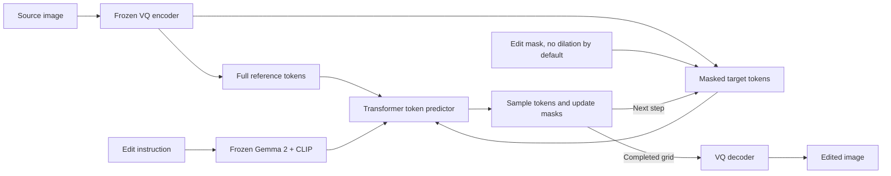

# EditMGT

**Instruction-guided image editing with Masked Generative Transformers.**

[Paper](https://arxiv.org/abs/2512.11715) · [Project page](https://weichow23.github.io/EditMGT/) · [Released weights](https://huggingface.co/WeiChow/EditMGT) · [CrispEdit-2M](https://huggingface.co/datasets/WeiChow/CrispEdit-2M) · [Upstream repository](https://github.com/weichow23/editmgt)

EditMGT edits a source image according to a text instruction. It represents images as discrete visual tokens and repeatedly predicts masked tokens until the edited image is complete. This repository includes the released model, local fine-tuning with **full-reference / sparse-target editing**, optional text/reference caching, and benchmark runners for Inter-Edit and MagicBrush.

- [Model architecture](#model-architecture)
- [Setup and checkpoints](#setup-and-checkpoints)
- [Training data](#training-data)
- [Training](#training)
- [Inference](#inference)
- [Benchmarks](#benchmarks)
- [Script reference](#script-reference)
- [License and citation](#license-and-citation)

## Model architecture

Think of the model as filling in missing pieces of an image while looking at the original image and reading the edit instruction.

1. **Encode the inputs.** A frozen VQ image encoder converts the source into discrete tokens. Frozen Gemma 2 supplies instruction-token features, while CLIP supplies a global text embedding.
2. **Prepare the target.** For mask-guided sparse editing, copy source tokens outside the generation region and mask tokens inside it. By default, the original VQ-grid edit mask defines that region, with no extra dilation. An optional surrounding border, called the **halo**, can be enabled explicitly.
3. **Predict visual tokens.** The Transformer attends to the instruction, the full reference image, and the active target tokens. The sampler keeps confident predictions and leaves uncertain positions masked for later steps.
4. **Decode the result.** Once sampling finishes, the VQ decoder turns the complete token grid into the output image. Mask-guided edit-only inference preserves source tokens outside the generation region and decodes them together with generated tokens. There is no RGB compositing by default.



The released local configuration in `checkpoint/EditMGT/editmgt/config.json` uses:

| Component | Configuration |
| --- | --- |
| Image tokenizer | VQ encoder/decoder with an 8,192-entry codebook |
| Text conditioning | Gemma 2 token features through a linear connector; pooled CLIP embedding |
| Transformer | 14 multimodal blocks + 28 single-stream blocks |
| Hidden size | 1,024, with 8 attention heads |
| Spatial grids at 1024 × 1024 | 64 × 64 VQ tokens; 32 × 32 Transformer tokens after downsampling |
| Prediction head | Upsampling and a masked-token classifier over the VQ codebook |

### Full reference, sparse target

The **reference branch keeps the entire source image**. Only target cells covered by the edit mask, with an optional halo, pass through the Transformer blocks. Active target features are gathered once before the blocks and scattered back once afterward, before upsampling and token prediction. Original spatial coordinates are retained, with separate position types for text, reference, and target tokens; an additional embedding describes the active region's height and width.

Training defaults to **halo=0: no dilation**. Corruption, masked-token cross-entropy and inference remasking use the original VQ-grid edit mask. The zero-halo path does not downsample and fill the mask back to whole Transformer cells, which would unnecessarily activate neighbouring VQ tokens. Transformer attention still uses OR projection to select cells that contain editable VQ tokens, without a morphological dilation. Source tokens outside the generation mask are copied and receive no loss. Text encoders and the VQ model remain frozen during fine-tuning. All English training launchers inherit the same zero-halo default through `scripts/train_en.sh` and `scripts/train.sh`; `SPARSE_TARGET_HALO` or `--sparse_target_halo` can explicitly re-enable a halo.

The sample inference, validation, pipeline and benchmark defaults all use `sparse_target_halo=0`, including when loading an older checkpoint trained with one or two cells. Passing `sparse_target_halo=None` explicitly to the pipeline/validation helper restores the saved radius for historical reproduction. Changing the halo does not change parameter shapes, so training can resume an older checkpoint with dilation disabled. If a positive halo is explicitly selected, its tokens remain supervised by default; `--no-supervise_target_halo` instead makes it context-only. Without an input mask, inference uses the full target sequence.

The **generation mask** is the original VQ edit mask by default, or an expanded region if a positive supervised halo is explicitly enabled. Training composes target/source tokens according to this region, and inference fixes source tokens outside it at every sampling step. The default `preserve_unmasked_pixels=False` decodes the complete composed token grid directly, for final outputs and intermediate previews, without a second RGB composition. VQ reconstruction and the decoder's spatial context can change RGB outside the annotation even when its source tokens are unchanged. For historical reproduction, `preserve_unmasked_pixels=True` or CLI `--preserve-unmasked-pixels` explicitly restores hard source-RGB compositing outside the original pixel mask. `output_type="latent"` returns tokens without decoding. These choices do not change the reference/text cache policy.

### Optional text/reference KV caching

`scripts/train_en_causal.sh`, `scripts/train_en_causal_resume.sh`, and the shared training launcher use a condition-cache threshold of **0.8** by default. Training, validation, sample inference, and benchmark generation all use **0.8** for the prefix phase and cache capture:

| Phase | Text and reference branches | Target branch |
| --- | --- | --- |
| High noise | Joint attention with the target | Attends to text, reference, and target |
| Low noise | Attend only to text/reference, with fixed time conditioning | Continues attending to all branches with its current time conditioning |

At inference, the first eligible low-noise forward stores each layer's text/reference keys and values. Later steps process target queries against that cached context. Target keys and values are recomputed, and caches are cleared between generations. Training computes every branch with gradients and never reuses a persistent cache.

For 18-step unshifted cosine generation, the cache reuse counts are:

| Threshold | Cache capture (1-based step) | Later steps reusing text/reference K/V |
| --- | ---: | ---: |
| 0.3 | 16 | 2 |
| 0.6 | 12 | 6 |
| 0.7 | 11 | 7 |
| 0.8 | 9 | 9 |

These counts omit repeated condition-branch computation; the target still receives all 18 model forwards. The default 0.8 captures on forward 9 and reuses text/reference K/V on forwards 10–18. Larger thresholds change the condition-prefix attention phase earlier in generation; continued training adapts the model to that change.

`init_edit_mgt` applies the runtime prefix threshold after loading a cache-conditioned model, including older checkpoints saved with 0.3. `infer.py` and benchmark runners expose `--condition-cache-threshold` (prefix attention phase) and `--reference-kv-cache-threshold` (capture threshold), both defaulting to 0.8. Capture is bounded by the active prefix phase. Benchmark run settings record the requested phase, and generation records include the effective phase, original loaded phase, and actual capture/reuse steps. Use both flags explicitly to reproduce another threshold. The original dense vanilla benchmark entries keep caching disabled.

Older models support a separate **reference-only snapshot cache**. Because their reference states depend on the evolving target, that cache is an approximation. Joint text/reference caching requires a checkpoint trained with `cache_conditioning` enabled. Use `--disable-condition-kv-cache` to compare recomputation under the same trained attention rules.

Implementation: [model](src/transformer.py), [pipeline](src/pipeline.py), [sampler](src/scheduler.py), [sparse token utilities](src/sparse_utils.py), [KV caches](src/reference_cache.py).

## Setup and checkpoints

Run commands from the repository root. Prepare the environment without starting training:

```bash
bash scripts/setup_env.sh
```

Training launchers call this setup automatically. If `.venv/bin/python` exists (including a symlink), setup immediately skips all environment and dependency installation without inspecting the Python version, its base interpreter location, or installed packages. This also applies to environments referencing `/root/.local/share/uv/python`, regardless of `SKIP_INSTALL`.

Only when `.venv/bin/python` is absent does setup install `uv` at `.tools/uv/uv`, managed Python 3.10 under `.tools/python`, and third-party packages in `.venv`; downloads are cached under `.cache/uv`. Any incomplete `.venv` is preserved as `.venv.backup-<timestamp>-<pid>` before creation. The installer uses [uv's unmanaged installation mode](https://docs.astral.sh/uv/reference/installer/#unmanaged-installations), so it does not modify shell profiles. Neither a global `uv` nor root access is required. The Python and cache locations use [uv's storage overrides](https://docs.astral.sh/uv/reference/storage/). Both single-GPU and multi-GPU training use `.venv/bin/python`.

The default PyTorch packages are `torch==2.11.0` and `torchvision==0.26.0` from the CUDA 13.0 index. Select a suitable build for your machine with `TORCH_VERSION`, `TORCHVISION_VERSION`, and `PYTORCH_INDEX_URL`. Set `UV_BIN` explicitly to use an existing uv executable; `UV_INSTALL_DIR`, `UV_PYTHON_INSTALL_DIR`, and `UV_CACHE_DIR` can override the local storage paths.

Start the English causal training run from step 0 with automatic setup:

```bash
bash scripts/train_en_causal.sh
```

Download the released checkpoint into `checkpoint/EditMGT` if it is not already present:

```bash
.venv/bin/python -c 'from huggingface_hub import snapshot_download; snapshot_download("WeiChow/EditMGT", local_dir="checkpoint/EditMGT")'
```

The local training and benchmark workflows need this layout:

```text
checkpoint/EditMGT/
├── editmgt/          # Released editing Transformer
├── text_encoder/     # CLIP text encoder
├── tokenizer/        # CLIP tokenizer
├── llm_encoder/      # Gemma 2 model and tokenizer
├── vqvae/            # Image tokenizer and decoder
└── scheduler/        # Masked-token sampling configuration
```

`src/editmgt.py` assembles these components. Local training loads the `editmgt` subfolder. The original `infer.py` demo defaults to the Hugging Face model ID `WeiChow/EditMGT`; the local inference and benchmark scripts default to `checkpoint/EditMGT`.

## Training data

The local launchers use **Inter-Edit**, optionally mixed with **MagicBrush** and **MaskEdit-10K**. The no-dilation resume launcher enables all three and uses the completed Qwen3.5-9B translation overlay for Chinese Inter-Edit training instructions. CrispEdit-2M is linked above as the upstream project's dataset; it is not the default data source of these launchers.

| Dataset / split | Available examples | Use in this repository |
| --- | ---: | --- |
| Inter-Edit train | 1,099,964 pairs | Default training source, all languages |
| Inter-Edit train, original English | 475,890 pairs | English launchers without a translation overlay |
| Inter-Edit train, translated Chinese | 624,074 pairs | Combined with original English by the no-dilation resume launcher |
| MaskEdit-10K train | 9,613 pairs | 7,310 non-Chinese pairs used by the no-dilation resume launcher |
| MaskEdit-10K test | 1,600 pairs | Held out from training |
| Inter-Edit test | 6,250 pairs; 3,413 English | Fixed previews and benchmark evaluation |
| MagicBrush train | 8,807 edit turns in the local release | Optional training mixture |
| MagicBrush dev | 528 edit turns | Held-out single-turn and multi-turn evaluation |
| MagicBrush official test | Separate download | Explicit test benchmark runs |

Counts describe metadata before missing/empty-mask exclusions. Inter-Edit's English training filter keeps instructions containing Latin letters and no Han characters. Test filtering uses official language labels, so an English instruction can still contain literal Chinese text to render. Translation is performed offline. `--inter_edit_translations_dir` overlays the completed English instructions before language filtering and tokenization, retaining literal Chinese text that the edit asks to render. The original-English plus translated-Chinese training pool has 1,099,964 pairs; test validation keeps the original official English subset.

### Inter-Edit layout

The default root is `/mnt/geminihzceph/public/data/Inter-Edit`. Override it with `--instance_data_dir` for training or `--data-dir` for benchmark/analysis scripts.

```text
Inter-Edit/
├── train/
│   ├── manifest.json
│   ├── metadata/train-*.jsonl.gz
│   ├── source_shards/*.tar
│   └── asset_shards/*.tar
└── test/
    ├── metadata.json
    ├── source_images.tar
    ├── target_images.tar
    └── masks.tar
```

[InterEditDataset](src/inter_edit_dataset.py) streams metadata and reads images directly from tar archives. It builds member-offset indexes under `data/inter_edit_tar_index`; no extraction or custom train/test split is required. `--dataset_cache_dir` changes the cache location.

To translate Chinese training instructions into a separate English JSONL with Qwen3.5-9B and vLLM, use [scripts/translate_inter_edit.sh](scripts/translate_inter_edit.sh). It defaults to eight independent GPU replicas and saves each batch for automatic resume. Use the prepared vLLM environment; the wrapper does not install dependencies or change Torch. `PYTHON_BIN=/path/to/python` selects its interpreter, `--model` accepts a local model directory, and `--tp-size` controls GPUs per replica.

#### Translate the Chinese test instructions

The official test release contains 2,837 Chinese and 3,413 English instructions. [scripts/translate_inter_edit_test.sh](scripts/translate_inter_edit_test.sh) translates the Chinese-labelled rows with Qwen3.5-9B, leaving original English rows unchanged, including English instructions that quote Chinese image text:

```bash
bash scripts/translate_inter_edit_test.sh

# Equivalent direct entry point:
bash scripts/translate_inter_edit.sh --split test \
  --output-dir ./data/inter_edit_test_zh_to_en_qwen35_9b
```

The default is eight independent single-GPU vLLM replicas. Test metadata is one JSON array (or JSONL file), so its Chinese rows are divided into durable chunks of 256 requests and assigned across the replicas. `--test-shard-size` changes this partition size. Batches are flushed and synced to disk; rerun the same command to resume without repeating completed requests. The GPU count and batch size may change on resume, while the model, source metadata, chunk partition and generation configuration must match. Train and test outputs use separate directories, and existing train translation releases remain compatible.

The test output directory contains:

```text
data/inter_edit_test_zh_to_en_qwen35_9b/
├── run_config.json
├── shards/test-*.jsonl           # Batch checkpoints, Chinese rows only
├── errors/*.errors.json
├── translations.jsonl           # All 2,837 Chinese-to-English mappings, in source order
├── metadata_en.json             # All 6,250 test rows after translation
├── metadata_en.jsonl            # The same full metadata in JSONL format
└── summary.json
```

Only a complete, unlimited run exports the full English metadata. `--limit N --output-dir /separate/directory` translates a smaller selection without exporting a partly translated full test set. Each translated metadata row keeps its original `index`, edit type, source/target/mask paths, and saves `instruction_original` and `language_original`; its effective instruction is English and its effective language is `English`. Literal Chinese text that an edit asks to render is retained. Original metadata, image archives and the training split are unchanged.

Readers can load the completed release with `InterEditReader(original_data_root, "test", translations_dir=translation_output_dir)`. They verify the split, source metadata identity, row indices, sample IDs, original instructions and completeness before applying translations. Test translations are never accepted as a training overlay.

To evaluate the translated English variant, select it explicitly and use a separate output directory:

```bash
python -m eval.benchmark_inter_edit \
  --checkpoint /path/to/checkpoint-N \
  --translations-dir ./data/inter_edit_test_zh_to_en_qwen35_9b \
  --language en --output-dir ./outputs/inter_edit_test_translated_en
```

With the completed translation overlay, `--language en` includes all 6,250 test cases. Benchmark selection preserves original instructions and records the translation files/model as provenance. Without `--translations-dir`, the official metadata and original language subsets are used. To use the translated cases in training previews after translation completes, append `--validation_translations_dir ./data/inter_edit_test_zh_to_en_qwen35_9b` to the training launcher. Test data remains validation/evaluation data; it is not mixed into training.

### MagicBrush layout and mixture

Place the local parquet release under `data/magicbrush`:

```text
data/magicbrush/data/
├── train-*.parquet
└── dev-*.parquet
```

Each row contains `img_id`, `turn_index`, `instruction`, `source_img`, `target_img`, and `mask_img`. [MagicBrushDataset](src/magicbrush_dataset.py) reads bounded PyArrow batches, using each turn's supplied source image, including its edit history. The general mixed launcher samples **80% English Inter-Edit / 20% MagicBrush per example**. The no-dilation resume launcher samples **70% Inter-Edit (original English + translated Chinese) / 20% MagicBrush / 10% MaskEdit-10K**. Streams repeat, and optimizer steps determine run length. Only MagicBrush `train` shards enter training.

All training samples use **white = edit, black = preserve** masks, accepting both 0/1 and 0/255 encodings. Source, target, and mask receive aligned resizing/cropping; crops are adjusted to retain a localized edit. Mask downsampling preserves thin regions. Empty masks are excluded and logged under the dataset cache's `empty_masks/train/` directories; MagicBrush also excludes missing masks. Data is sharded across ranks/workers, while the original dataset files remain unchanged.

The local MagicBrush `mask_img` is an **RGBA source-image cutout**, with transparent pixels marking the edit region. Its RGB values contain scene colors and must not be thresholded as mask labels. Both training and benchmark readers decode the inverted alpha channel into the white=edit convention before resizing or converting to grayscale. L/RGB binary mask exports retain their existing convention. Mask-guided MagicBrush runs record `edit_mask_decoding=magicbrush_alpha_cutout_v1`; use a new output directory for corrected generation, because `--resume` rejects outputs made with the previous decoder. Mask-free vanilla runs do not consume these masks. Checkpoints previously trained on MagicBrush cutouts used the old masks; correcting inference does not undo that training history.

### MaskEdit-10K

The local release is `data/MaskEdit-10K/data/{scene,infographics_cn,infographics_en}/train-*.parquet`. [MaskEditDataset](src/maskedit_dataset.py) reads bounded parquet batches from `scene` (4,804 samples) and `infographics_en` (2,506 samples), for 7,310 training pairs. The entire `infographics_cn` configuration (2,303 samples) is excluded. Only `train-*` files enter training. The reader also rejects Chinese `content_language` labels and any selected instruction containing Han characters, including mixed English/Chinese instructions and quoted Chinese text. Eligible counts read only text columns; rejected rows are skipped before image decoding and tokenization.

Training uses the detailed `edit_instruction` field and the provided source/target/white edit mask with shared resizing/cropping. `--maskedit_prompt_field prompt` selects the alternate prompt and replaces `[MASK_AREA]` with `the masked area`. `--maskedit_configs` can select configurations. The reader divides whole files across DDP ranks and DataLoader workers, without padding or a second Accelerate data-loader split.

## Training

### Choose a launcher

All shell training launchers live in `scripts/`; the Python implementation and YAML configurations live in `train/`. All variants inherit sparse-target editing, zero halo by default, and the base optimization settings from `scripts/train.sh`.

| Launcher in `scripts/` | Data and additional behavior | Default directory under `runs/` |
| --- | --- | --- |
| `train.sh` | Inter-Edit, all languages | `editmgt_sparse_inter_edit` |
| `train_en.sh` | English Inter-Edit | `editmgt_sparse_inter_edit_en` |
| `train_en_cache.sh` | English Inter-Edit + cache conditioning | `editmgt_sparse_inter_edit_en_cache` |
| `train_en_cache_magicbrush.sh` | English Inter-Edit / MagicBrush mixture + cache conditioning; corrected alpha masks, pure cosine, normalized time, 10% text dropout | `editmgt_sparse_inter_edit_en_cache_magicbrush_maskfix` |
| `train_en_cache_magicbrush_no_dilation.sh` | Corrected alpha masks; fresh initialization from original EditMGT; fixed halo=0 and no halo supervision | `editmgt_sparse_inter_edit_en_cache_magicbrush_no_dilation_maskfix` |
| `train_en_cache_magicbrush_no_dilation_resume.sh` | 70% translated+original English Inter-Edit / 20% MagicBrush / 10% MaskEdit-10K; restore full checkpoint state; fixed halo=0 | `editmgt_sparse_inter_edit_en_cache_magicbrush_no_dilation_maskfix` |

For example, train the English/cache-conditioned mixture using an existing environment:

```bash
SKIP_INSTALL=1 REPORT_TO=none \
  bash scripts/train_en_cache_magicbrush.sh \
  --instance_data_dir /path/to/Inter-Edit \
  --max_train_steps 10000
```

The launcher respects `CUDA_VISIBLE_DEVICES` and uses one worker per visible GPU. A single worker runs directly; multiple workers use Accelerate. To select two GPUs explicitly:

```bash
SKIP_INSTALL=1 GPU_IDS=0,1 NUM_PROCESSES=2 REPORT_TO=none \
  bash scripts/train_en_cache_magicbrush.sh
```

### Fresh no-dilation experiment

Start training from the original local EditMGT pretrained weights, with a new optimizer, scheduler state and global step 0:

```bash
bash scripts/train_en_causal.sh
```

This starts fresh fine-tuning of `checkpoint/EditMGT/editmgt`, rather than random initialization of all weights. It keeps the English Inter-Edit / MagicBrush training mixture, cosine sampling, normalized mask-ratio time conditioning, 10% text dropout, complete reference and low-noise text/reference cache policy. Both training and validation fix `sparse_target_halo=0` and disable halo supervision. Corruption, loss and inference remasking use the original VQ edit mask by default, or the bbox-augmented training mask when enabled; active Transformer cells still cover their underlying editable tokens without morphological dilation. Validation directly decodes the composed token grid without RGB compositing.

The output directory defaults to `runs/inter_brush_maskedit_en_no_dilation_mrcache0.8_d0.1_fresh`. The launcher creates the requested directory if needed and writes directly into it when it already exists, without adding a timestamp suffix. Set `TRAIN_OUTPUT_DIR` to choose another path. `--fresh_start` overrides the inherited automatic resume, starts at global step 0, and rewrites `run_initialization.json` with the initialization source and `edit_mask_decoding=magicbrush_alpha_cutout_v1`. New outputs replace files at the same paths, while other existing files remain in place. Ordinary optimization options such as learning rate and batch size remain configurable; the profile appends its zero-halo and fresh-start settings after user arguments so those cannot accidentally be overridden.

After training has saved a checkpoint, reproduce its own English validation cases with:

```bash
bash scripts/infer_inter_edit_no_dilation.sh
```

This selects the highest `checkpoint-N` in the corrected-mask run directory, loads that run's `validation/samples.json`, and uses halo=0. Use `--run-dir /path/to/new-run` for another run or `--checkpoint /path/to/checkpoint-N` for a specific saved step. The entry accepts only zero-halo checkpoints with halo supervision disabled and does not fall back to an older experiment. Outputs default to `outputs/inter_edit_no_dilation_maskfix`. The general benchmark scripts already default to halo=0 and can evaluate these checkpoints normally.

To resume this experiment later, use the general mixed launcher with the same `TRAIN_OUTPUT_DIR` and `--no-supervise_target_halo --resume_from_checkpoint latest`; omit `--fresh_start`. The dedicated fresh launcher always initializes from pretrained weights at step 0.

To continue the existing `runs/editmgt_sparse_inter_edit_en_cache_magicbrush_no_dilation/checkpoint-2600` with corrected masks:

```bash
SKIP_INSTALL=1 bash scripts/train_en_cache_magicbrush_no_dilation_resume.sh
```

This restores model, optimizer, scheduler and available RNG state from the corrected `_maskfix/checkpoint-6800` run and continues saving into that run directory. It retains the previous checkpoint's training history and uses corrected MagicBrush masks for subsequent batches. `run_initialization.json` records the source checkpoint and starting step. Later invocations prefer the latest checkpoint in the output directory when it is newer than step 6800; set `RESUME_FROM_CHECKPOINT=/path/to/checkpoint-N` to select another source explicitly. `--max_train_steps` is the absolute stopping step, including the restored 6800 steps. The preview launcher above follows this same corrected run directory.

The resume launcher enables completed translations from `data/inter_edit_zh_to_en_qwen35_9b` and the non-Chinese MaskEdit-10K train configurations (`scene`, `infographics_en`) under `data/MaskEdit-10K`. Its default per-example probabilities are 70% Inter-Edit, 20% MagicBrush and 10% MaskEdit. It independently converts each training mask to its filled bounding box with 10% probability (`MASK_BBOX_PROB=0.1`). It defaults to `SKIP_INSTALL=1` to reuse the prepared training environment. Model, optimizer, scheduler and available RNG state continue from the existing latest corrected checkpoint; changing the data pool does not restart the global step.

This launcher sets `CONDITION_CACHE_THRESHOLD=0.8` and explicitly enables `--allow_condition_cache_threshold_change_on_resume`, allowing the step-6800 checkpoint's threshold to migrate from 0.3 to 0.8 while restoring its weights, optimizer, scheduler, step and available RNG state. Only the threshold may change; cache-conditioning mode, time conditioning and loss-reduction compatibility checks remain in place. Old checkpoint files are unchanged. Each distinct threshold transition is recorded under `condition_cache_transitions/`. The resumed model needs subsequent updates to adapt to the earlier cache phase. Set `CONDITION_CACHE_THRESHOLD=0.6` or `0.7` before this launcher to select another phase; the same environment variable configures both training and validation.

```bash
SKIP_INSTALL=1 bash scripts/train_en_cache_magicbrush_no_dilation_resume.sh

# Optional path/probability overrides; Inter-Edit receives 1 - 0.2 - 0.1.
INTER_EDIT_TRANSLATIONS_DIR=/path/to/completed_translations \
MASKEDIT_DATA_DIR=/path/to/MaskEdit-10K \
MAGICBRUSH_PROBABILITY=0.2 MASKEDIT_PROBABILITY=0.1 \
SKIP_INSTALL=1 bash scripts/train_en_cache_magicbrush_no_dilation_resume.sh
```

Equivalent Python options are `--inter_edit_translations_dir`, `--maskedit_data_dir`, `--magicbrush_probability`, and `--maskedit_probability`. An incomplete, limited, stale or mismatched translation release is rejected. Existing Chinese samples receive the translated instruction once; they are not duplicated as separate image pairs. Data provenance and rank-local counts/probabilities are written to `data_mixture/rank_XXXX.json`; earlier configurations are retained in `data_mixture/history/` when the mixture changes. Qualitative validation continues to use the original official Inter-Edit English test cases.

### Main settings

Settings come from the shell launchers and `train/train.py` arguments. `train/train_edit.yaml` belongs to the legacy parquet reader and does not configure the default Inter-Edit run. Extra CLI arguments appended to a launcher override its earlier values.

| Setting | Launcher default | Override |
| --- | --- | --- |
| Base model | `./checkpoint/EditMGT`, subfolder `editmgt` | `--pretrained_model_name_or_path`, `--transformer_subfolder` |
| Resolution / precision | 1024 / FP32 | `--resolution`, `--mixed_precision` |
| Batch per GPU / accumulation | 4 / 8 | `--train_batch_size`, `--gradient_accumulation_steps` |
| Learning rate / schedule | `1e-4` / constant | `--learning_rate`, `--lr_scheduler` |
| Optimizer | 8-bit AdamW | `USE_8BIT_ADAM=0` for PyTorch AdamW |
| Gradient clipping | 10 | `--max_grad_norm` |
| Training length | 500,000 optimizer steps | `--max_train_steps` |
| Checkpoint / preview interval | 200 / 200 steps | `--checkpointing_steps`, `--validation_steps` |
| Halo / cache transition | 0 cells, no dilation / 0.8 mask fraction | `SPARSE_TARGET_HALO`, `CONDITION_CACHE_THRESHOLD` |
| Text condition dropout | 0.1 in MagicBrush mixed launchers; 0 in other launchers | `COND_DROPOUT_PROB`, `--cond_dropout_prob` |
| Training mask → bbox probability | 0.1 in the no-dilation resume launcher; 0 in other launchers | `MASK_BBOX_PROB`, `--mask_bbox_prob` |
| MagicBrush probability | 0.2, in mixed launchers | `MAGICBRUSH_PROBABILITY` |
| Output directory | Per-launcher directory above | `TRAIN_OUTPUT_DIR` |
| Resume | Latest checkpoint in that output directory | `--resume_from_checkpoint` |
| Execution | Eager; compilation disabled | `COMPILE_MODEL=1`, optional `COMPILE_BACKEND` |

Effective global batch size is `batch_per_gpu × number_of_GPUs × accumulation_steps` (32 × the GPU count by default). Keep optimizer type and saved sampling/time settings consistent when resuming. Architecture changes require separate output directories. Resuming training permits a condition-cache threshold migration to the requested value (0.8 by default), restores full training state, and records transition history. Pass `--no-allow_condition_cache_threshold_change_on_resume` to require an exact threshold match instead. Cache-conditioning mode and time-conditioning compatibility checks remain in place.

For LoRA and gradient checkpointing:

```bash
SKIP_INSTALL=1 REPORT_TO=none TRAIN_OUTPUT_DIR=./runs/editmgt_en_cache_lora \
  bash scripts/train_en_cache.sh \
  --use_lora --lora_r 32 --lora_alpha 128 --gradient_checkpointing
```

`REPORT_TO=none` disables external tracking; `WANDB_MODE=offline` keeps W&B logs locally. Online W&B logging uses the authenticated account's default entity, with optional `WANDB_ENTITY` and `WANDB_PROJECT` overrides.

### Training mask-to-bbox augmentation

Set `MASK_BBOX_PROB` (or `--mask_bbox_prob`) to a value in `[0,1]` to independently replace that fraction of training masks with their filled, axis-aligned bounding boxes. For example, to start a fresh no-dilation experiment with a 30% probability:

```bash
SKIP_INSTALL=1 MASK_BBOX_PROB=0.3 \
  TRAIN_OUTPUT_DIR=./runs/editmgt_en_cache_magicbrush_bbox_p03 \
  bash scripts/train_en_cache_magicbrush_no_dilation.sh
```

The conversion happens after aligned resizing/cropping and before VQ-grid projection, for Inter-Edit, MagicBrush and MaskEdit-10K. Each selected mask uses one tight box around all positive pixels, filling holes, concavities and gaps between disconnected regions without adding padding beyond the box. Empty masks remain empty. The augmented mask consistently controls sparse target selection, token corruption, source-token preservation and loss, with any explicitly enabled halo applied afterward. Target tokens throughout the box are supervised against the target image. This exposes training to a broader context around irregular boundaries; its effect on visible seams needs to be checked in validation.

The no-dilation resume launcher defaults to `0.1`; other launchers and the Python parser default to `0`. Setting `0` disables augmentation without consuming additional random numbers; `1` always selects nonempty masks. The probability is recorded in `mask_augmentation_config.json` in the run directory and every checkpoint, and `mask_bbox_fraction` logs the selected fraction across ranks for the current microbatch. Existing checkpoints can resume with the new probability using the same training arguments plus `--mask_bbox_prob 0.1`. Validation/inference retain their original annotation masks for token-region selection and directly decode the composed tokens, without RGB compositing by default. The debug panel continues to show the original pixel mask next to the actual generation-token mask, including bbox augmentation when selected.

### Mask-ratio sampling

Let `r` be the fraction of generation-region tokens to mask: `0` is clean and `1` is fully masked. `train.sh`, `train_en.sh` and `train_en_cache.sh` retain the legacy defaults: `r = cos(pi*u/2)` with uniform `u`, legacy time conditioning, and cross-entropy averaged over supervised tokens.

All training launchers use **100% cosine sampling**, with no shift, lognormal draws or mixture components. The shared launcher fixes this recipe, and the sampler rejects other modes. Training draws a uniform progress value `u` and maps it to `r = cos(pi*u/2)`; validation and inference evaluate the same curve at fixed progress values `i/N`.

`train_en_cache_magicbrush.sh` uses normalized `TIME_CONDITIONING=mask_ratio` and `MASK_LOSS_REDUCTION=sample`. Text condition dropout is 0.1: one shared decision replaces both Gemma sequence features and pooled CLIP features with their empty-prompt features. Source/reference conditioning is retained. Validation defaults to an empty negative prompt and source-token preservation outside the generation region, with no RGB compositing. With zero halo, loss is restricted to masked tokens in the training VQ edit region, including bbox augmentation when enabled.

The historical lognormal launcher is no longer included. Use `scripts/train_en_cache_magicbrush.sh` for cosine sampling. Historical checkpoint directories can be explicitly selected for resume or inference.

`timestep_sampling_config.json` records the effective cosine recipe. Resuming a historical lognormal, shifted or mixed-noise checkpoint automatically continues with cosine and records the old/new recipes in `sampler_transition.json`; its model, optimizer and step are restored. Saved time conditioning and loss reduction must still match. For a historical normalized-time checkpoint, use `bash scripts/train_en_cache_magicbrush.sh --resume_from_checkpoint /path/to/checkpoint-N`. A separate output directory retains the old experiment's reports. The old `--allow_sampler_change_on_resume` flag remains accepted for command compatibility and is no longer required.

### Checkpoints and previews

A full training run produces:

```text
<run-dir>/
├── checkpoint-N/
│   ├── transformer/                 # Model config and weights
│   ├── timestep_sampling_config.json
│   └── ...                          # Optimizer, scheduler, and RNG state
├── validation/
│   ├── samples.json                 # Fixed test cases and prompts
│   ├── selection.json               # Selected official test indices
│   ├── inputs/                      # Exported source, mask, and GT images
│   ├── index.html
│   └── step_NNNNNN/                 # Comparisons, contact sheet, metadata
├── data_mixture/rank_XXXX.json       # Mixed runs: counts and probabilities
└── timestep_sampling_config.json
```

The final Transformer is also saved at the run root. LoRA runs save adapter weights/configuration plus sparse, cache, and time-conditioning metadata instead of a full Transformer.

Five fixed Inter-Edit test cases are previewed at startup, every 200 steps, and at the final step, using seed `42 + sample_id`. English launchers select original English test cases across edit types. Ground truth is used for display. Adjust with `--validation_num_images`, `--validation_sample_indices`, or `--validation_steps`; previews are qualitative checks, not full benchmark scores.

Preview contact sheets and HTML reports show the original annotation mask in red and the actual token generation mask in orange. Halo is disabled by default; remaining differences between the overlays come from pixel/VQ discretization. The red overlay is an annotation reference, rather than an RGB compositing boundary. Each sample directory also saves `generation_mask.png` and `generation_mask_overlay.png`. Metadata records the actual halo, generation-mask coverage and output-compositing policy.

## Inference

### Released model demo

```bash
.venv/bin/python infer_vanilla.py --num-samples 5
```

This runs the released model on five English Inter-Edit training examples and saves image comparisons and an HTML report under `outputs/inter_edit_train_vanilla`. Defaults follow the [official EditMGT demo](https://github.com/weichow23/EditMGT/blob/main/infer.py): resolution 1024, 36 sampling steps, guidance scale 6, reference strength 1.1, the official negative prompt, FP32 and no explicit generation seed. Source RGB is resized with Pillow's default bicubic interpolation, and `generated.png` is resized back to the original source dimensions. `generated_model.png` retains the model-resolution result for comparison panels.

### Inspect a trained sparse checkpoint

The preview script expects a full training checkpoint containing `transformer/` and an exported validation manifest:

```bash
bash scripts/infer_inter_edit_sparse.sh \
  --checkpoint runs/editmgt_sparse_inter_edit_en_cache/checkpoint-1000 \
  --samples-manifest runs/editmgt_sparse_inter_edit_en_cache/validation/samples.json \
  --output-dir outputs/sparse_checkpoint_1000
```

It reuses source images, prompts, and annotation masks from validation; defaults are 18 steps, guidance 6, reference strength 1.0, and FP32. Halo and cache behavior follow the checkpoint. `--disable-reference-kv-cache` disables reuse; `--disable-condition-kv-cache` specifically disables the joint cache.

For the released model on the same cases:

```bash
.venv/bin/python infer_vanilla.py \
  --samples-manifest runs/editmgt_sparse_inter_edit_en_cache/validation/samples.json \
  --num-inference-steps 18 --reference-strength 1.0 \
  --negative-prompt "" --seed 42 \
  --output-dir outputs/vanilla_same_cases
```

This vanilla preview uses source images and instructions without mask conditioning, KV reuse or RGB compositing. Its default sampling settings follow the official demo: 36 steps, guidance 6, reference strength 1.1, resolution 1024, the official `src.v2_model.negative_prompt` and FP32. Generation uses the global RNG without resetting it per case. `--seed N` explicitly enables reproducible `N + sample_id` case seeds; `--negative-prompt ""` and `--bf16` remain optional overrides. The command above intentionally overrides the official defaults for a seeded comparison against the trained model's 18-step settings. For benchmark comparisons with a shared mask/cache protocol, use the benchmark runners' `--vanilla` option.

With no manifest, it selects examples directly from the **train** split using the same selection and empty-mask handling as `infer.py` (currently 50 English cases), then applies the official RGB bicubic resize:

```bash
.venv/bin/python infer_vanilla.py \
  --model-path checkpoint/EditMGT \
  --num-samples 50 --language en \
  --output-dir outputs/inter_edit_train_vanilla
```

Use `--sample-indices 12 345 678 --language all` for exact global train indices, or `--selection random --selection-seed 42` for reproducible sample selection. To compare the same examples with a trained model, pass `--samples-manifest outputs/inter_edit_train/checkpoint-6800/samples.json`; this reuses every exported source, prompt and sample ID in manifest order. Add `--seed 42` to match the trained model's per-case seeds. Legacy test manifests also remain supported. Original instructions are retained unless the manifest explicitly provides `instruction_en`. Manifest PNGs retain any previous resampling history; select rows directly from the archives when the original image preprocessing is required.

The original Transformer comes from `--model-path/editmgt`; optional `--checkpoint` selects another original Transformer directory or full checkpoint. The vanilla entry rejects sparse, token-type RoPE, cache-conditioned and normalized-time checkpoints. Its `index.html`, `contact_sheet.png`, per-sample comparisons, `samples.json`, `selection.json` and `metadata.json` record the baseline inputs and settings, including effective negative text, seed policy, interpolation and output sizes. Each case saves `generated.png` at original source size and `generated_model.png` at the model resolution; panels use the latter. Annotation masks appear only in the exported comparison panels. `--prepare-only` exports inputs without loading weights. The script uses this repository's local pipeline implementation; matching demo settings does not replace that implementation with a separate upstream checkout. All sample-inference and cache-ablation launchers use the repository's `.venv/bin/python`.

### Visualize examples from the Inter-Edit training split

Read examples directly from the official **train** archives, using the selected `checkpoint-5200` by default:

```bash
bash scripts/infer_inter_edit_train.sh \
  --checkpoint runs/editmgt_sparse_inter_edit_en_cache_magicbrush_no_dilation_maskfix/checkpoint-5200 \
  --num-samples 5 --language en \
  --bf16 --device cuda:0 \
  --output-dir outputs/inter_edit_train_preview
```

`--checkpoint` defaults to `runs/editmgt_sparse_inter_edit_en_cache_magicbrush_no_dilation_maskfix/checkpoint-5200`. Override it with either a full `checkpoint-N` directory or a Transformer directory containing `config.json` and weights. `--model-path` supplies the frozen components (default `checkpoint/EditMGT`). The launcher invokes the current `infer.py` entry using the repository's `.venv/bin/python`.

By default, the script chooses the first five English training examples with nonempty masks. Use `--selection random --selection-seed 42` to shuffle metadata shards and rows reproducibly. To select exact examples, pass `--sample-indices 12 345 678 --language all`; these are zero-based global train row indices **before** language filtering, in the requested order, and override `--num-samples`. Explicit indices with a language mismatch or an empty mask raise an error. Instructions remain in their original language. `--data-dir` accepts the Inter-Edit root or its `train/` directory.

The output contains `index.html`, `step_NNNNNN/contact_sheet.png`, per-sample `generated.png` and `comparison.png`, and the exported source/GT/mask inputs. Comparisons show the source, original mask overlay, internal generation region when available, GT and generated image; the HTML report includes the instruction. `samples.json`, `selection.json` and step metadata record the original train indices, prompts, checkpoint, generation parameters and seeds (`--seed + sample_id`). Only the source, instruction and edit mask condition generation; GT is displayed for comparison. Defaults are 1024 resolution, 18 steps, guidance 6, reference strength 1, FP32, halo=0 and source-token preservation outside the generation region, with no RGB compositing.

Add `--prepare-only` to export `train_inputs.png` and selected inputs without loading model weights. This still requires the dataset/image dependencies, but no GPU. These examples come from the training split and are intended for inspecting fit; they do not measure held-out quality.

### Ablate the number of KV reuse steps

`tests/ablate_cache_steps.py` compares **17, 8, 3 and 0 KV reuse forwards** by default, using the same checkpoint, source images, masks, instructions, generation seeds and 18-step cosine schedule. **Prefill is excluded from the count.** The no-cache baseline retains the checkpoint's trained low-noise attention mask and fixed context modulation. Model weights are loaded once, with a fresh cache and the same per-case RNG seed for every generation.

```bash
bash scripts/ablate_cache_steps.sh \
  --checkpoint runs/editmgt_sparse_inter_edit_en_cache_magicbrush_no_dilation_maskfix/checkpoint-5200 \
  --num-samples 5 --cache-steps 17 8 3 0 --bf16 \
  --warmup 1 --repeats 3 \
  --output-dir outputs/cache_steps_checkpoint_5200
```

The four default schedules are:

| KV reuse forwards | Prefill forward (one-based) | Full recomputation forwards, including prefill | Later reuse forwards |
| ---: | ---: | ---: | --- |
| 17 | 1 | 1 | 2–18 |
| 8 | 10 | 10 | 11–18 |
| 3 | 15 | 15 | 16–18 |
| 0 | None | 18 | None |

The ablation uses a fixed runtime prefix threshold of `0.8` by default, including for checkpoints originally saved with `0.3`. With this phase, native low-noise caching can reuse up to nine of 18 forwards: the 8/3-forward variants capture within the active phase, while the 17-forward variant uses an **approximate early snapshot**. That variant captures high-noise text/reference states, which can depend on the evolving target and time conditioning, then freezes those K/V tensors for all remaining forwards. It does not refresh the snapshot when entering the low-noise phase. The active attention threshold is held fixed across every variant, including no cache; the report labels approximate variants `early_snapshot`. `plan.json` records both the runtime and saved checkpoint thresholds. Pass `--condition-cache-threshold 0.3` to reproduce the historical two-reuse-step phase.

The exact forward count is passed to the pipeline via `condition_kv_cache_reuse_steps`, and early capture is allowed explicitly via `allow_early_condition_cache`. These pipeline options default to native behavior outside the ablation script. `--no-allow-early-cache --cache-steps 0 3 8 9` restricts an experiment to the default 0.8 low-noise phase; requests above the native limit are then rejected. A no-cache baseline is always included, and explicit variant order is preserved. The runtime records and checks the actual prefill/reuse indices for every generation.

To compare just first-forward caching against no reuse, run:

```bash
bash scripts/ablate_cache_steps.sh \
  --checkpoint runs/editmgt_sparse_inter_edit_en_cache_magicbrush_no_dilation_maskfix/checkpoint-7200 \
  --num-inference-steps 18 --cache-steps 17 0 --allow-early-cache \
  --num-samples 5 --warmup 1 --repeats 3 \
  --output-dir outputs/cache_first_step_ablation_7200
```

This captures per-layer text/reference KV on forward 1 and reuses that same cache on forwards 2–18, without refreshing at the prefix-phase transition. The target branch still runs on all 18 forwards. The report includes matched images, edit-region crops, difference maps, quality metrics, timings and speedups for both variants.

`infer.py` and all trained-model benchmark entries also accept `--cache-first-step` for this same policy. With any total of N forwards it requests exactly N−1 reuse forwards and allows the early snapshot, while keeping `--condition-cache-threshold` fixed. It cannot be combined with disabled caching or a vanilla model. For example, score and visualize the first-step-cache variant on PIE-Bench using a separate output directory:

```bash
bash eval/benchmark_pie_bench.sh \
  --num-inference-steps 18 --cache-first-step \
  --output-dir outputs/pie_bench_checkpoint-7200_first_step_cache
```

Benchmark settings record the first-step policy, and per-sample records retain the actual zero-based capture/reuse indices (`capture_step: 0`, `reuse_steps: [1, ..., 17]`). These settings are included in resume matching.

Use `--samples-manifest outputs/inter_edit_train/checkpoint-5200/samples.json` to reuse an existing selection exactly (all manifest entries are used). Otherwise, the script selects training examples using the shared inference reader; `--sample-indices`, `--language`, `--selection`, `--selection-seed` and `--data-dir` work as in `infer.py`. A nonempty mask is required for each case. Defaults are five English training examples, resolution 1024, 18 steps, guidance 6, reference strength 1, FP32, halo=0 and no RGB compositing. `--plan-only` exports the schedule without reading images or loading models; `--prepare-only` also exports selected inputs. Both require only the checkpoint config, not GPU inference.

The report includes:

- `index.html` and `contact_sheet.png`: matched source, mask, GT and generated images across reuse counts.
- Per-sample `roi_comparison.png`, `differences.png` and generated PNGs: enlarged edit regions and differences from the no-cache result, with adjustable `--difference-gain` (default 8).
- `cache_schedule.png`/`.svg`: the recompute, prefill and reuse forwards for each variant.
- `speed_quality.png`/`.svg`: end-to-end time, paired speedup, edit-region PSNR against GT, and pixel MAE against GT and the no-cache result.
- `summary_table.png`/`.svg`, the HTML table and `summary.csv`: one row per reuse count, listing recomputation count, capture index/mode, seconds, speedup, images/second, edit-region PSNR/MAE, outside-mask source MAE and differences from no cache. Per-sample HTML tables also list requested versus actual reuse counts and paired times.
- `plan.json`, `metadata.json`, `records.json`, `summary.json` and `summary.csv`: configuration, actual cache observations, per-case timings, metrics and aggregates.

Timing excludes model loading, warmups, PNG writes and metric calculation. It includes the full pipeline call (text encoding, source VQ encoding, Transformer forwards and decoding), synchronizes CUDA before and after each measurement, and uses the median of repeated timings for each case/variant. Variant order is shuffled reproducibly for each repetition. Speedup divides the sum of paired no-cache case times by the sum of variant case times; error bars show variation across cases, not confidence intervals. Images and pixel metrics use the first measured repetition. Pixel MAE and PSNR measure fidelity rather than semantic edit quality. Summary PSNR is computed from the mean per-case MSE; exact matches are represented by JSON `null`, CSV `inf` and an infinity symbol in the HTML table. Plot export uses Matplotlib from `requirements.txt`. Use a new output directory for another experiment; existing measurements are preserved.

### Cosine inference schedule

Training previews, sparse inference, vanilla inference and both benchmark runners use the same unshifted cosine mask schedule, `r_i = cos(pi*i/(2*N))`. There are `N` model forwards and a final clean state `r_N=0`. Model noise conditioning, remasking and cache capture use this cosine schedule. Older scheduler configs are normalized to cosine when generation starts.

`--inference-shift 1` remains accepted for existing commands; other values are rejected. Shift environment variables no longer affect training or inference. In `mask_ratio` mode, the model embeds `1000*r_i`. In `legacy` mode, inference passes `1000*r_i` to the Transformer, which applies its existing internal x1000 scaling, matching the historical training scale of `1,000,000*r_i`. Scheduler step IDs are not used as model noise conditions. This corrects legacy inference outputs without changing legacy training or checkpoint weights.

## Benchmarks

The standalone runners generate edited images and compute objective metrics. They accept full training checkpoints, final Transformer directories, and LoRA checkpoints through `--checkpoint`. Use `--vanilla` for the released editing Transformer. Common generation defaults are **1024 resolution, 18 steps, guidance 6, reference strength 1.0, seed 42, provided annotation masks, and 0.8 for both condition-prefix and KV-capture thresholds**.

The Python benchmark entries and four `eval/benchmark_*.sh` launchers live under `eval/`. The launchers change to the project root and invoke `python -m eval.benchmark_*`, so they also work when called by absolute path from another directory. Direct Python commands should use the same module form from the project root, for example `python -m eval.benchmark_magicbrush --help`.

### Original EditMGT without masks

Two dedicated entry points evaluate the original dense EditMGT using only source RGB and the edit instruction. They load `checkpoint/EditMGT/editmgt` through the local base model, with no fine-tuned `--checkpoint`, sparse target, token-type RoPE, KV reuse or pixel compositing. Generation does not read annotation masks. Inter-Edit's regional metrics read the annotation masks only during scoring; MagicBrush's default metrics require no masks.

```bash
# MagicBrush: 8 GPUs, local dev split, independent and continuous editing.
bash eval/benchmark_magicbrush_vanilla.sh \
  --data-dir data/magicbrush --split dev --mode both \
  --output-dir outputs/benchmark_magicbrush_dev_vanilla

# Inter-Edit: 8 GPUs, official English test subset; the mask is for metrics only.
bash eval/benchmark_inter_edit_vanilla.sh \
  --language en \
  --alpha-clip-ckpt checkpoint/AlphaCLIP/clip_l14_grit1m_fultune_8xe.pth \
  --output-dir outputs/inter_edit_en_vanilla
```

Defaults follow the original `infer.py` sampling settings: **36 steps, guidance 6, reference strength 1.1, FP32**, and the original negative prompt from `src/v2_model.py`. All time schedules use cosine. To match the sparse benchmark's sampling settings, pass `--num-inference-steps 18 --reference-strength 1.0 --negative-prompt ""`. `--model-path` may select another original EditMGT base directory containing `editmgt`, `vqvae` and the frozen encoders. Mask-guided or trained sparse models belong in the general benchmark runners; the native entries reject those settings.

These entries use the same datasets, selection, seed derivation, metric implementations, timing scope and output layout as the sparse benchmarks. MagicBrush defaults to L1, L2, CLIP-I and DINO, with separate single-turn/all-turn and multi-turn/final-turn scores. Inter-Edit defaults to LPIPS, AlphaCLIP inside/outside and the boundary metric. `--metrics lpips,boundary` selects an explicit subset when AlphaCLIP weights are unavailable. Generated PNGs are under `images/`, per-image records under `records/`, and scores under `metrics/per_sample.jsonl` and `metrics/summary.json`. `--resume`, `--limit`, `--stage generate` and `--stage metrics` work as in the general runners.

All four benchmark shell launchers default to **8 GPU data parallelism**. Each worker loads a full model on one visible GPU. Inter-Edit distributes independent test samples evenly without duplication or padding; fewer selected samples launch fewer workers. MagicBrush assigns complete sessions by size: all turns and independent/continuous variants of a session stay on the same GPU, preserving multi-turn dependencies. Sampling settings and per-sample seeds are unchanged.

```bash
CUDA_VISIBLE_DEVICES=0,1,2,3,4,5,6,7 \
  bash eval/benchmark_magicbrush_vanilla.sh

# Select another worker count, including the original single-GPU path.
NUM_GPUS=1 bash eval/benchmark_magicbrush_vanilla.sh
# Or set the worker count on the command line:
bash eval/benchmark_magicbrush_vanilla.sh --num-gpus 4
```

The Inter-Edit launchers use `.venv/bin/python`. MagicBrush retains its `PYTHON_BIN` / `.venv` interpreter selection. Both spawn local Python workers; no separate `torchrun` command is needed. Direct Python entry points default to one GPU and accept `--num-gpus 8`. `--device cuda:N` selects the first of consecutive visible devices; CUDA metric devices follow the same rule, while `--metric-device cpu` scores on CPU.

`--stage all` finishes every generation worker before launching parallel metric workers. Metric-model initialization is serialized to protect shared weight downloads; scoring then runs concurrently. The parent retains the output lock, merges per-image scores into the existing global summaries, and records worker details under `parallel_execution.json` and `workers/<launch-id>/rank-*/`. GPU count can change on `--resume` when generation settings and selection are otherwise identical.

### Metric dependencies

```bash
bash scripts/setup_benchmark_env.sh
```

This explicit installer adds LPIPS, OpenAI CLIP, [AlphaCLIP](https://github.com/SunzeY/AlphaCLIP), and their dependencies to the existing `.venv`. It uses uv with `--python .venv/bin/python` when available, otherwise `.venv/bin/python -m pip` (bootstrapping pip with ensurepip if needed). It does not recreate the training environment, start evaluation, or change the training launcher's existing-environment skip behavior. Benchmark launchers do not invoke installation automatically.

Inter-Edit's regional metrics additionally need matching AlphaCLIP visual weights, supplied with `--alpha-clip-ckpt`; a `.pth` file alone does not install the `alpha_clip` package. LPIPS, CLIP, and DINO can download weights on first use. `--model-cache-dir` selects the model cache; offline DINO scoring accepts `--dino-repo` and `--dino-weights`.

AlphaCLIP's [setup.py](https://github.com/SunzeY/AlphaCLIP/blob/main/setup.py) and runtime import `pkg_resources`, which [setuptools removed in version 82](https://setuptools.pypa.io/en/latest/history.html#v82-0-0). The installer first prepares `setuptools<82` and `wheel`, then installs `requirements-benchmark.txt` with build isolation disabled. The requirements now include `loralib` and AlphaCLIP explicitly. With pip already available, the equivalent commands are:

```bash
.venv/bin/python -m pip install 'setuptools<82' wheel
.venv/bin/python -m pip install --no-build-isolation -r requirements-benchmark.txt
```

DINO loading skips Torch Hub's GitHub branch/tag API validation for the fixed `facebookresearch/dino:main` repository, avoiding API rate-limit errors and the resulting `KeyError: 'Authorization'` in affected Torch versions. The initial repository and weight downloads still require network access unless cached or supplied locally. If generation has finished and metric loading fails, rerun with `--stage metrics --output-dir <existing-output-dir>` to score the saved images without loading EditMGT or generating them again.

### Inter-Edit test

```bash
bash eval/benchmark_inter_edit.sh \
  --checkpoint runs/editmgt_sparse_inter_edit_en_cache_magicbrush_no_dilation_maskfix/checkpoint-5200 \
  --data-dir /mnt/geminihzceph/public/data/Inter-Edit \
  --language en \
  --alpha-clip-ckpt checkpoint/AlphaCLIP/clip_l14_grit1m_fultune_8xe.pth \
  --output-dir outputs/inter_edit_en_checkpoint_5200
```

The trained launcher currently defaults to checkpoint-7200 on eight GPUs; the example above explicitly selects checkpoint-5200. `bash eval/benchmark_inter_edit_vanilla.sh` evaluates released EditMGT on the same English subset and writes to `outputs/inter_edit_en_vanilla`. Both scripts use `.venv/bin/python`, and expose `NUM_GPUS`, `INTER_EDIT_DATA_DIR`, `INTER_EDIT_LANGUAGE`, `ALPHA_CLIP_CKPT` and `OUTPUT_DIR` configuration variables; the trained launcher also exposes `CHECKPOINT`. Trailing CLI arguments override the script defaults. Use `--resume` to continue the same checkpoint and generation settings.

`--language en` selects the 3,413 English test examples; `--language all` selects all 6,250. `--limit N` or `--sample-indices ...` selects a recorded subset. Original test IDs and prompts are retained. Inter-Edit mask-conditioned generation and scoring skip examples whose mask annotation/file is missing, whose mask is entirely black, or whose mask becomes empty at the generation resolution. Skips are recorded as `status=skipped` with a reason in `records/`, and listed/countable in `generation_summary.json` and `metrics/summary.json`; all other errors retain their normal failure behavior. Native mask-free generation still does not read masks, while its regional scoring excludes missing/empty-mask examples.

The original `selection.json` and generation settings remain unchanged, allowing an interrupted existing run to continue with `--resume` after this fix. Previously completed valid images are reused; previous empty-mask errors become explicit skips. `selected_predictions` records the original selection size, `expected_predictions` excludes skipped examples, and `scored_predictions` is the actual metric count. `complete` means every remaining eligible case was scored, with at least one eligible case; `full_selection_scored` additionally requires that no selected case was excluded. Metric averages and timing exclude skipped cases, so reports with exclusions describe the valid subset rather than an unqualified full-benchmark score.

Metrics follow the protocol implemented in [src/benchmark_metrics.py](src/benchmark_metrics.py), based on the [Inter-Edit objective evaluator](https://github.com/Delong-liu-bupt/Inter-Edit/blob/main/evaluation/objective_metrics.py):

| Saved metric | Comparison | Better |
| --- | --- | --- |
| `S_global_LPIPS` | Generated vs. GT image, AlexNet LPIPS | Lower |
| `S_in_AlphaCLIP` | Generated vs. GT inside the edit mask | Higher |
| `S_out_AlphaCLIP` | Generated vs. source outside the edit mask | Higher |
| `BSS_Laplacian` | Difference in mean Sobel gradient magnitudes across boundary rings | Lower |

The boundary metric retains the upstream key despite using Sobel gradients. Regional scoring always uses the **original annotation mask**, independently of generation halo. Images are aligned to native source size unless `--metric-resolution` is set. Reference-object scoring is unavailable when the dataset supplies no separate reference-object image. `--metrics lpips,boundary` runs a declared subset without AlphaCLIP.

### MagicBrush dev and official test

The default evaluates the held-out local **dev split**, with independent and continuous editing:

```bash
bash eval/benchmark_magicbrush.sh \
  --checkpoint runs/editmgt_sparse_inter_edit_en_cache/checkpoint-1000 \
  --split dev --mode both \
  --output-dir outputs/benchmark_magicbrush_dev
```

- **Single-turn:** every turn starts from its provided source image.
- **Multi-turn:** the first turn starts from its source; later turns use the preceding generated result. The main score uses the final output of each session.

Default metrics are `l1,l2,clip-i,dino`. These need no caption file. To evaluate the separately distributed [official test release](https://github.com/OSU-NLP-Group/MagicBrush#dataset-access), extract its `edit_sessions.json` and `images/<image_id>/` folders, then run:

```bash
bash eval/benchmark_magicbrush.sh \
  --checkpoint runs/editmgt_sparse_inter_edit_en_cache/checkpoint-1000 \
  --data-dir /path/to/magicbrush_test --split test --mode both \
  --caption-file /path/to/global_description.json \
  --metrics l1,l2,clip-i,dino,clip-t \
  --output-dir outputs/benchmark_magicbrush_test
```

The reader also accepts split-specific parquet files and flat JSON/JSONL manifests through `--manifest`. Metrics follow the [MagicBrush image evaluator](https://github.com/OSU-NLP-Group/MagicBrush/blob/main/evaluation/image_eval.py):

| Metric | Definition | Better |
| --- | --- | --- |
| `l1` | Mean absolute RGB error in [0, 1] | Lower |
| `l2` | Mean squared RGB error | Lower |
| `clip-i` | Generated/GT cosine similarity, CLIP ViT-B/32 | Higher |
| `dino` | Generated/GT cosine similarity, DINO v1 ViT-S/16 | Higher |
| `clip-t` | Generated image vs. target global caption, CLIP | Higher |
| `clip-t-oracle` | GT image vs. the same caption; reported with CLIP-T | Higher |

CLIP-T requires **target global descriptions**, not edit instructions. Summaries keep `single_turn_all` and `multi_turn_final` separate; `multi_turn_all_diagnostic` is an additional diagnostic. Dev and test results retain their split labels.

### Outputs, resume, and scoring saved images

```text
<output-dir>/
├── run.json                    # Checkpoint identity, dataset scope, generation settings
├── selection.json              # IDs, prompts, asset locators, evaluation groups
├── execution.json              # Hardware, precision, loaded model policy
├── generation_summary.json     # Completion counts and timing
├── images/                     # Generated PNGs
├── records/                    # Per-image seeds, timing, memory, cache details
└── metrics/
    ├── per_sample.jsonl
    ├── summary.json            # Aggregate scores, counts, and breakdowns
    └── errors.jsonl
```

Use `--resume` with identical checkpoint/settings/selection to continue an interrupted run. Use a new output directory for changed settings. Generation and scoring can run separately:

```bash
bash eval/benchmark_inter_edit.sh \
  --checkpoint runs/editmgt_sparse_inter_edit_en_cache/checkpoint-1000 \
  --stage generate --language en --output-dir outputs/inter_edit_run

bash eval/benchmark_inter_edit.sh \
  --stage metrics --output-dir outputs/inter_edit_run \
  --alpha-clip-ckpt /path/to/clip_l14_grit1m_fultune_8xe.pth
```

Metrics-only mode reads the saved run without loading EditMGT; original dataset assets must remain accessible. `--stage all` releases the editing model before loading metric models. Timing includes prompt/VQ encoding, token sampling, and decoding, with one unmeasured warmup by default; disk I/O and scoring are excluded. Reports include peak GPU memory and cache reuse details.

For comparable results, match checkpoint, split/subset, mask protocol, halo, pixel-compositing policy, steps, guidance, precision, cache policy, and metric set. Every runner uses cosine scheduling. The default `--mask-mode provided` supplies annotation masks to the model, disables dilation with halo=0, and preserves source tokens outside the generation region. The complete token grid is decoded and resized for export without RGB compositing at either generation or native resolution. Outside-mask metrics therefore measure the decoded result, including VQ reconstruction changes. This default applies to both vanilla and sparse mask-guided runs and is recorded as `preserve_unmasked_pixels=false` and `output_compositing=none`. Explicit `--preserve-unmasked-pixels` restores the historical source-RGB composition at both resolutions. A change in this policy requires a separate benchmark output directory; `--resume` rejects mismatched settings. `--mask-mode none` selects mask-free inference and disables sparse-target generation and pixel compositing. Partial or failed runs are labeled in summaries and exit with a nonzero status.

### GEditBench-EN legacy scripts

`eval/geditbench/` retains the original generation and VLM scoring workflow:

```bash
uv pip install --python .venv/bin/python megfile==4.1.4
PYTHONPATH=. .venv/bin/python eval/geditbench/infer.py --method_name editmgt
```

Images are written to `eval/geditbench/results/editmgt/fullset/<task_type>/en/<key>.png`. This entry point loads the released model and uses 36 steps. It does not expose a fine-tuned `--checkpoint` argument.

`rate.py` requires manual setup: replace its literal `<YOUR KEY>` placeholders with valid quoted paths to API-key files and configure the selected evaluator. Then create the score directory and use a consistent backbone for rating and aggregation:

```bash
mkdir -p eval/geditbench/score_dir/editmgt/gpt4.1
PYTHONPATH=. .venv/bin/python eval/geditbench/rate.py \
  --model_name editmgt --backbone gpt4.1 --instruction_language en \
  --edited_images_dir eval/geditbench/results \
  --save_dir eval/geditbench/score_dir
PYTHONPATH=. .venv/bin/python eval/geditbench/stat.py \
  --model_name editmgt --backbone gpt4.1 --language en \
  --save_path eval/geditbench/score_dir
```

These scripts report semantic consistency, perceptual quality, and overall scores. They are separate from the objective benchmark runners. See the [upstream evaluation guide](https://github.com/stepfun-ai/Step1X-Edit/blob/main/GEdit-Bench/EVAL.md) for the original protocol.

## PIE-Bench v1

The PIE-Bench runners read the existing local release at `data/PIE-Bench`, using its `mapping_file.json` and `annotation_images/`. They follow the dataset and metric definitions from the [official PnP Inversion repository](https://github.com/cure-lab/PnPInversion) and [evaluator](https://github.com/cure-lab/PnPInversion/tree/main/evaluation). The full release contains 700 cases across categories 0–9, including the random-edit category. PIE-Bench supplies source images, source/target descriptions, edit instructions and masks; preservation metrics compare generated images with their source images.

Install evaluation dependencies explicitly if needed, then select a checkpoint:

```bash
bash scripts/setup_benchmark_env.sh

CHECKPOINT=runs/editmgt_sparse_inter_edit_en_cache_magicbrush_no_dilation_maskfix/checkpoint-7200 \
  bash eval/benchmark_pie_bench.sh
```

Both launchers use `.venv/bin/python`. The trained launcher defaults to the checkpoint above, eight GPUs, `data/PIE-Bench`, and `outputs/pie_bench_checkpoint-7200`. Environment variables `CHECKPOINT`, `PIE_BENCH_DATA_DIR`, `NUM_GPUS`, and `OUTPUT_DIR` override these defaults. Trailing arguments override the corresponding CLI defaults:

```bash
NUM_GPUS=1 bash eval/benchmark_pie_bench.sh \
  --checkpoint /path/to/checkpoint-N \
  --output-dir outputs/pie_bench_custom \
  --limit 20 --bf16
```

Default trained-model settings match the existing sparse benchmark: 1024 generation resolution, 18 steps, guidance 6, reference strength 1, FP32, halo 0, annotation-mask conditioning and no RGB compositing. Cache-conditioned checkpoints use a runtime prefix threshold and capture threshold of 0.8, including older checkpoints saved with a different phase. `--condition-cache-threshold` and `--reference-kv-cache-threshold` override those values. Use `--disable-condition-kv-cache` to recompute the conditions, or `--preserve-unmasked-pixels` to opt into source-RGB compositing; the selected settings are recorded in `run.json` and per-image records. Choose a new output directory when switching thresholds; `--resume` requires the original generation settings.

For the released mask-free EditMGT baseline, use its dedicated entry, whose sampling defaults match the existing native baseline (36 steps, guidance 6, reference strength 1.1, original negative prompt, FP32):

```bash
bash eval/benchmark_pie_bench_vanilla.sh
```

The baseline saves to `outputs/pie_bench_vanilla`. Use explicit sampling and precision arguments when comparing models under shared settings. To run the released weights through the general mask-conditioned protocol instead, call `.venv/bin/python -m eval.benchmark_pie_bench --vanilla` with the desired options.

The generation text defaults to `editing_instruction`; `--prompt-field editing_prompt` selects the cleaned target description instead. CLIP scoring always uses the global source/target descriptions with the annotation brackets removed. Category and sample selection preserve official sample IDs, including leading zeros:

```bash
NUM_GPUS=1 bash eval/benchmark_pie_bench.sh \
  --categories 1 2 3 4 5 6 7 8 9 --limit 50 \
  --output-dir outputs/pie_bench_categories_1_to_9

NUM_GPUS=1 bash eval/benchmark_pie_bench.sh \
  --sample-ids 000000000000 --output-dir outputs/pie_bench_one
```

Resume generation with identical checkpoint/settings/selection, or split generation and scoring into separate commands:

```bash
bash eval/benchmark_pie_bench.sh --resume
bash eval/benchmark_pie_bench.sh --stage generate
bash eval/benchmark_pie_bench.sh --stage metrics
```

Use the same `OUTPUT_DIR` or `--output-dir` for both stages. The metrics stage reads the saved selection and images and does not load EditMGT. During multi-GPU `--stage all`, every generation worker finishes before scoring workers start. Each sample belongs to one worker; global summaries aggregate per-image results, including unequal shard sizes. Dependency installation is never invoked by the benchmark launchers.

The default eight metrics use the published evaluator's names:

| Metric | Definition | Better |
| --- | --- | --- |
| `structure_distance` | DINO ViT-B/8 last-layer key self-similarity MSE, source vs. generated | Lower |
| `psnr_unedit_part` | Background PSNR, source vs. generated | Higher |
| `lpips_unedit_part` | Background SqueezeNet LPIPS | Lower |
| `mse_unedit_part` | Background pixel MSE in [0,1] | Lower |
| `ssim_unedit_part` | Background SSIM with data range 1 | Higher |
| `clip_similarity_source_image` | Source image vs. source description, reference score | Higher |
| `clip_similarity_target_image` | Generated image vs. target description | Higher |
| `clip_similarity_target_image_edit_part` | Masked generated image vs. target description | Higher |

Metrics default to 512×512 scoring, independently of generation resolution. Regional metrics black out excluded pixels and evaluate the resulting full image, without region-area renormalization. Masks use zero-based `(start,length)` runs in row-major 512×512 coordinates, with the official edited-border correction. CLIP uses `openai/clip-vit-large-patch14` and reports `100 * max(cosine, 0)`; regional CLIP uses black outside the mask. Structure distance retains the upstream float [0,255] input before resizing and ImageNet normalization, includes the CLS token, and records the explicit resize antialias setting in `metrics/protocol.json`. Results use raw values: structure distance and LPIPS are not multiplied by the factors used in paper tables.

`--metrics` accepts a comma-separated subset of all 18 metrics: `psnr`, `lpips`, `mse`, `ssim`, and `structure_distance`, each optionally suffixed with `_edit_part` or `_unedit_part`, plus the three CLIP metrics above. For pixel-only background scoring without downloading metric models:

```bash
NUM_GPUS=1 bash eval/benchmark_pie_bench.sh \
  --stage metrics --metrics psnr_unedit_part,mse_unedit_part
```

The full metric suite can download CLIP, LPIPS and DINO weights on first use. `--model-cache-dir` selects the CLIP/DINO cache location; LPIPS uses the standard Torch Hub cache. Offline structure scoring accepts `--dino-repo /path/to/facebookresearch/dino --dino-weights /path/to/dino_vitb8_weights.pth`.

Outputs include generated `images/*.png`, `run.json`, `selection.json`, generation records/timing, `metrics/per_sample.jsonl`, `metrics/per_sample.csv`, `metrics/summary.json`, and `metrics/summary.csv`. Summaries contain overall and per-edit-type means, counts and incomplete-run status. Undefined empty-region scores are JSON `null` and excluded from means with `undefined_count`; exact-match PSNR is the string `inf`, retained in aggregate means. `index.html` shows source images, red mask overlays, generated images, instructions and scores for the first 50 samples; adjust `--report-limit` or set it to 0 to disable HTML. `--save-inputs` also exports original source images and masks.

## Script reference

| Entry point | Purpose |
| --- | --- |
| `train/train.py` | Training implementation; CLI uses underscore-separated options |
| `scripts/train*.sh` | Training presets described above; forward extra arguments |
| `infer.py` | Released-model example on an asset image |
| `infer_inter_edit_sparse.py` | Inspect a full sparse checkpoint on exported validation cases |
| `infer_inter_edit_train.py` | Inspect a manually chosen checkpoint on Inter-Edit train samples with PNG/HTML comparisons |
| `infer_inter_edit_vanilla.py` | Original mask-free EditMGT on train samples or exported train/test cases, with PNG/HTML comparisons |
| `ablate_cache_steps.py`, `scripts/ablate_cache_steps.sh` | Compare exact KV reuse counts with image grids, ROI differences, timings and plots |
| `eval/benchmark_inter_edit.py` | Official Inter-Edit test generation and scoring |
| `eval/benchmark_magicbrush.py` | MagicBrush independent and continuous editing evaluation |
| `eval/benchmark_pie_bench.py`, `eval/benchmark_pie_bench.sh` | PIE-Bench checkpoint inference, source-preservation/text metrics, multi-GPU evaluation and CSV/HTML reports |
| `eval/benchmark_pie_bench_vanilla.py`, `eval/benchmark_pie_bench_vanilla.sh` | PIE-Bench original mask-free EditMGT baseline |
| `scripts/infer_inter_edit_*.sh`, `eval/benchmark_*.sh` | Inference and benchmark launchers; Inter-Edit benchmarks use the active `python` |
| `scripts/analyze_edit_attention.py` | Image/text attention heatmaps, overlays, and region statistics |
| `scripts/test_zero_shot.py` | Qualitative zero-shot mask/editing experiments |
| `scripts/test_attention_mask.py` | Compare attention-derived masks and annotation masks |
| `scripts/visualize_generation_order.py` | Visualize token reveal order during sampling |
| `scripts/create_data_split.py` | Legacy parquet split by file, stratified by edit type |
| `eval/geditbench/{infer,rate,stat}.py` | Legacy GEditBench generation, VLM rating, and aggregation |

For example, inspect attention on one official Inter-Edit test case:

```bash
PYTHONPATH=. .venv/bin/python scripts/analyze_edit_attention.py \
  --model-path checkpoint/EditMGT \
  --data-dir /path/to/Inter-Edit \
  --num-cases 1 --layers 28 29 30 31
```

Regression tests are under `tests/`:

```bash
.venv/bin/python -m pytest tests -q
```

## License and citation

The repository's [LICENSE](LICENSE) is **CC-BY-4.0**.

```bibtex
@article{chow2025editmgt,
  title={EditMGT: Unleashing Potentials of Masked Generative Transformers in Image Editing},
  author={Chow, Wei and Li, Linfeng and Kong, Lingdong and Li, Zefeng and Xu, Qi and Song, Hang and Ye, Tian and Wang, Xian and Bai, Jinbin and Xu, Shilin and others},
  journal={arXiv preprint arXiv:2512.11715},
  year={2025}
}
```

## Region-DiMO: One-Step Regional Editing

Region-DiMO distills an EditMGT SFT Teacher into a one-step regional image editor. It adds independent training, inference and benchmark entries; existing EditMGT workflows remain available.

### Method

- **Frozen SFT Teacher:** provides the target token distribution.
- **One-step Student:** samples visual tokens once with independent categorical sampling.
- **Auxiliary distribution matching:** supplies the FKL surrogate direction and learns Student samples with hard cross-entropy. Student and Auxiliary updates use separate batches.
- **Student EMA:** maintains a moving-average inference model.
- **Mask-constrained generation and Halo:** generate within the edit region plus the configured Halo and lock source tokens outside it. Pass the original mask to the Transformer; decode the complete VQ token grid directly by default.

### Training

The v3 preset uses Teacher CFG=6, Student/Auxiliary CFG=1, frozen Student/Auxiliary embeddings and MLM heads, Student embedding perturbation=0.3, constant LR with 100-update warmup, AdamW (LR=1e-6, weight decay=0.01), and distillation Halo=1 with supervision enabled. It preserves per-sample FKL, Auxiliary hard CE with label smoothing=0.1, r_init=1 and EMA decay=0.9999 with warmup.

Copy `configs/dimo/region_dimo_v3.example.json` to a private configuration and fill exactly one SFT Teacher source, the base-component directory, training data/manifest settings and a **new** output directory. Do not resume an old B0 experiment with this recipe. Prepare `.venv` using the setup instructions above, then run:

```bash
export DIMO_CONFIG=/path/to/private_dimo_v3.json
.venv/bin/python -m src.dimo.preflight --config "$DIMO_CONFIG"
bash scripts/dimo/run_formal.sh --stop-after-preflight
# After the bounded preflight succeeds, continue the same v3 run:
bash scripts/dimo/run_formal.sh --resume latest
```

The launcher respects `CUDA_VISIBLE_DEVICES`; only explicit `GPU_IDS` overrides it. `NUM_PROCESSES` defaults to the visible GPU count. Set `DIMO_PYTHON` for an external prepared environment. Each rank holds all model roles; DDP does not partition their memory.

### One-Step Inference

Use `student` for raw weights or `ema` for averaged weights:

```bash
export DIMO_CHECKPOINT=/path/to/new_dimo_run/checkpoint-2000
export BASE_MODEL_DIR=/path/to/EditMGT-base
for model in student ema; do
  .venv/bin/python -m src.dimo.infer \
    --checkpoint "$DIMO_CHECKPOINT" --model "$model" --base-model-dir "$BASE_MODEL_DIR" \
    --source source.png --mask mask.png --prompt 'Make the object red.' \
    --output "outputs/dimo_${model}.png"
done
```

Inference uses CFG=1, embedding perturbation=0 and the checkpoint's saved Halo and supervision settings. `--halo 0` or `--halo 1` explicitly overrides the profile. RGB compositing is optional via `--preserve-unmasked-pixels`; the default is direct VQ decode.

### Benchmarks

The DiMO adapter reuses EditMGT's data order, prompts, masks, GPU sharding and metrics. Select `--backend student` or `--backend ema`; both use the saved Halo profile unless `--sparse-target-halo` is explicitly supplied. Effective Halo, supervision and their source are recorded in the output metadata.

```bash
.venv/bin/python -m src.dimo.benchmark --benchmark magicbrush --backend ema \
  --checkpoint "$DIMO_CHECKPOINT" --model-path "$BASE_MODEL_DIR" \
  --data-dir /path/to/MagicBrush --split test --mode both \
  --guidance-scale 1 --num-inference-steps 1 --metrics l1,l2 \
  --output-dir outputs/dimo_magicbrush

.venv/bin/python -m src.dimo.benchmark --benchmark inter_edit --backend ema \
  --checkpoint "$DIMO_CHECKPOINT" --model-path "$BASE_MODEL_DIR" \
  --data-dir /path/to/Inter-Edit --language en \
  --guidance-scale 1 --num-inference-steps 1 --metrics l1,l2 \
  --output-dir outputs/dimo_inter_edit
```

These examples select L1/L2; use the benchmark-specific metric options above for full scoring. Add `--num-gpus N` and `--bf16` explicitly when needed. `--backend teacher` retains the original benchmark defaults, including Halo=0; choose Teacher steps/CFG and a shared composition policy explicitly for comparisons. See [the Region-DiMO guide](docs/region_dimo.md) for checkpoint and configuration details.
