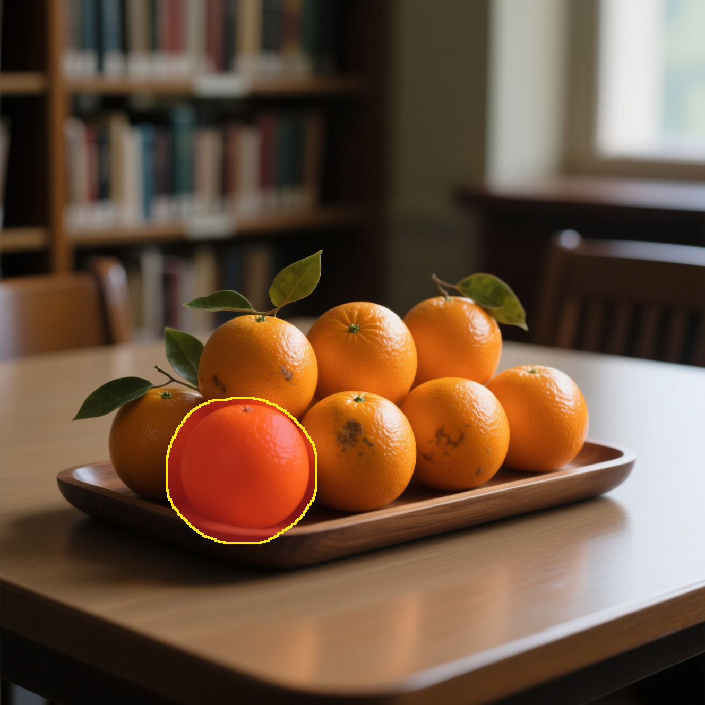
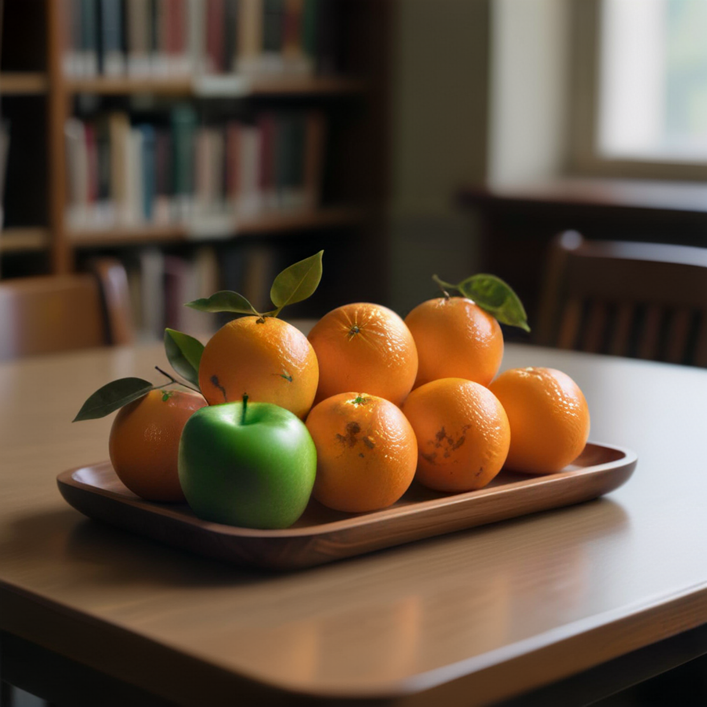
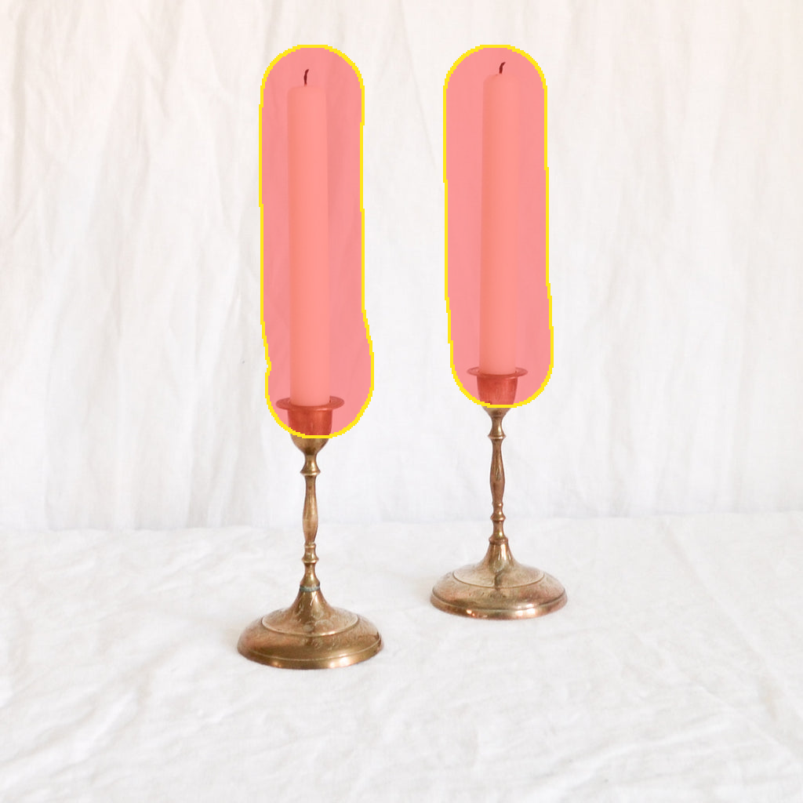
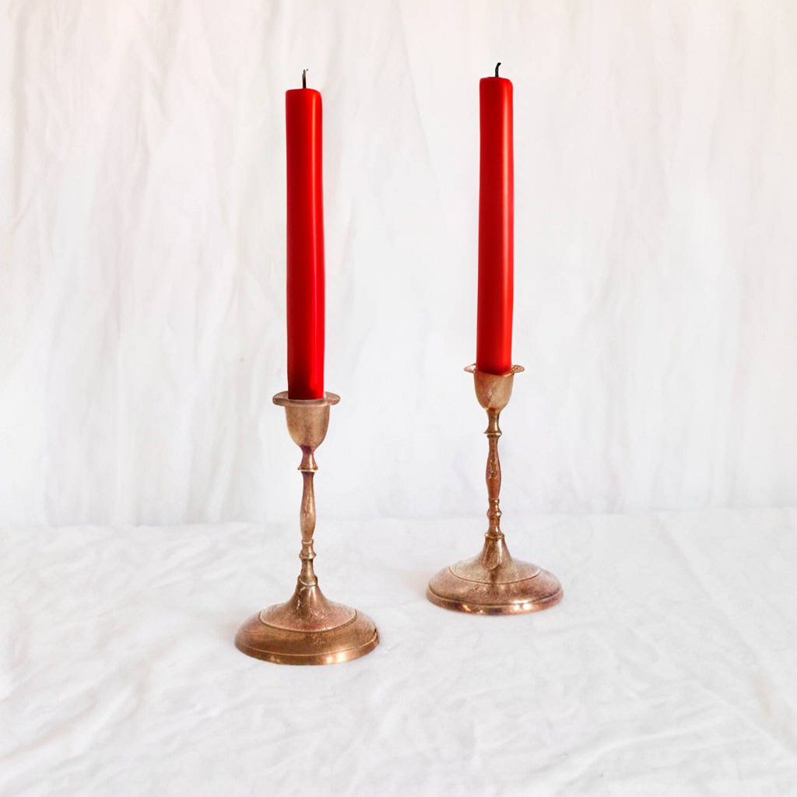
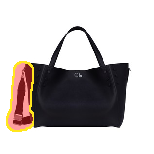
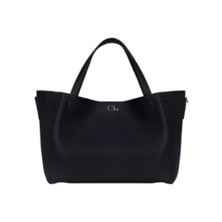
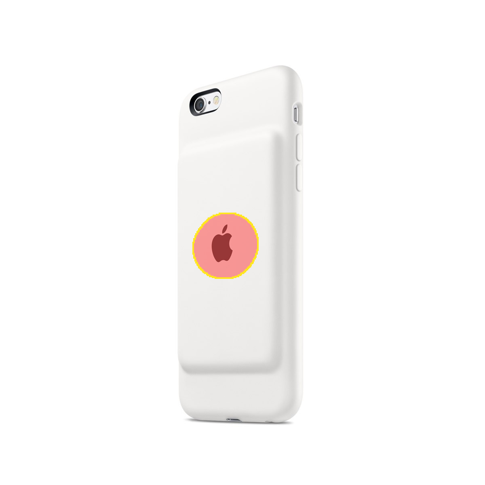
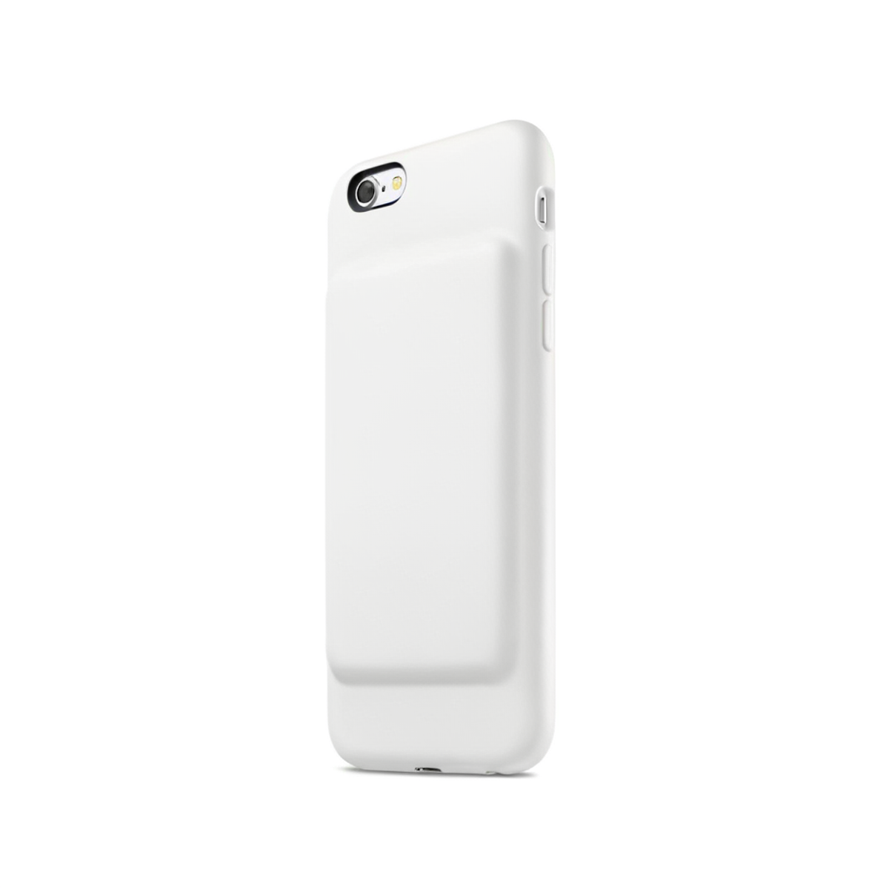
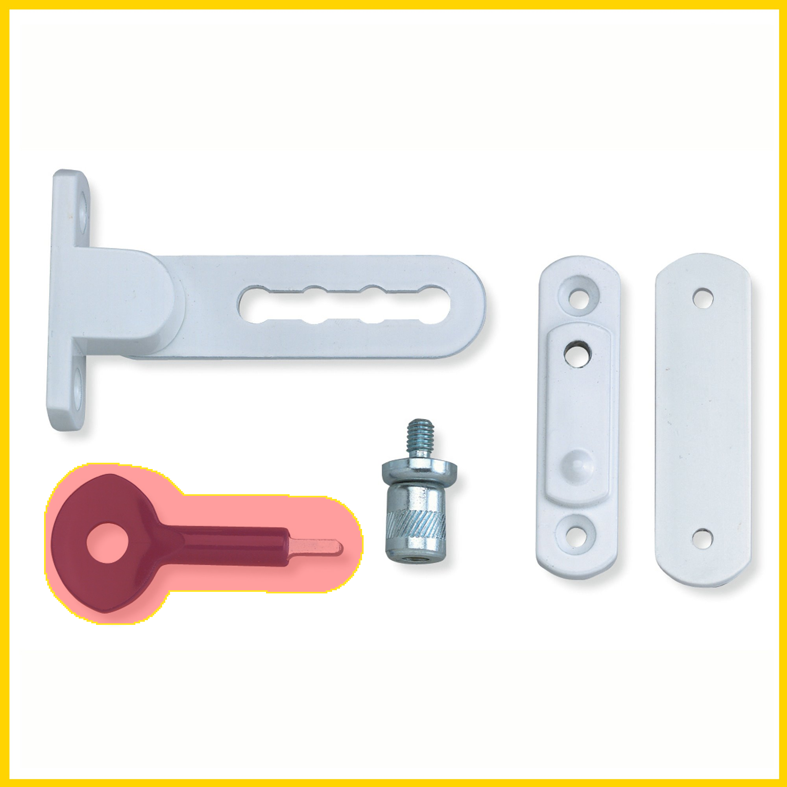
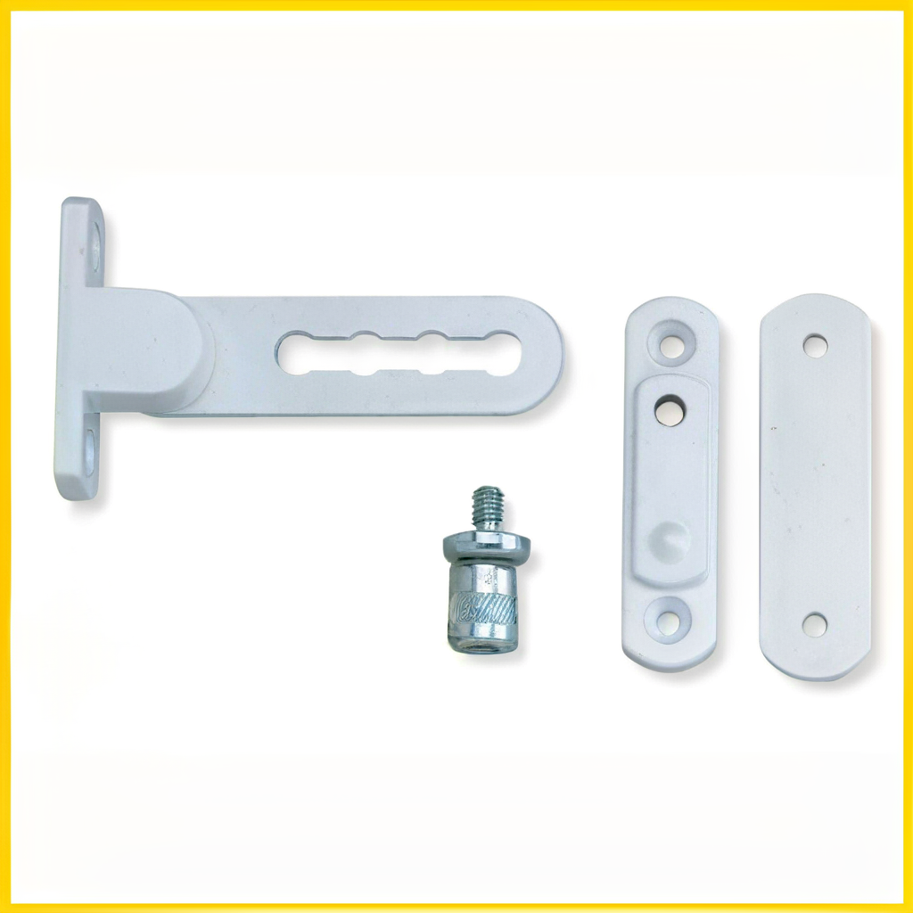

# DiMO qualitative results

本目录收录 12 个来自 Inter-Edit `test/en` 的 DiMO EMA-4000 1-step 编辑结果，覆盖 Add、Local、Remove 和 Texture 四类编辑，每类 3 个。候选样本先按 LPIPS 与编辑区/未编辑区 AlphaCLIP 综合排序，限制 mask 占比在 1%–35%，再通过人工可视检查排除不明显的编辑和显著伪影。这些是定性展示用的筛选案例，不代表整个测试集的平均质量。

每个样本文件夹都独立保存：

- `source.png`：原图。
- `mask.png`：二值编辑 mask，白色为编辑区。
- `source_mask_overlay.png`：原图与 mask 叠加图，红色半透明填充表示编辑区，黄色表示边界。
- `edited.png`：DiMO EMA-4000 1-step 输出。
- `instruction.txt`：编辑指令。

完整样本 ID、mask 占比和逐样本指标见 [manifest.json](manifest.json)。

| # | 类型 | Instruction | Source + mask | Edited |
|---:|---|---|---|---|
| 01 | Add | Add a red gemstone. |  [source](01_add_sample_01378/source.png) · [mask](01_add_sample_01378/mask.png) |  [instruction](01_add_sample_01378/instruction.txt) |
| 02 | Add | Insert a crescent moon with a subtle glow. |  [source](02_add_sample_02255/source.png) · [mask](02_add_sample_02255/mask.png) |  [instruction](02_add_sample_02255/instruction.txt) |
| 03 | Add | Add a silver ring, keep gloves black. |  [source](03_add_sample_05554/source.png) · [mask](03_add_sample_05554/mask.png) |  [instruction](03_add_sample_05554/instruction.txt) |
| 04 | Local | Replace the red bells with gold ones. |  [source](04_local_sample_00997/source.png) · [mask](04_local_sample_00997/mask.png) |  [instruction](04_local_sample_00997/instruction.txt) |
| 05 | Local | Replace the bottom orange with a green apple, maintaining the leaves attached. |  [source](05_local_sample_05750/source.png) · [mask](05_local_sample_05750/mask.png) |  [instruction](05_local_sample_05750/instruction.txt) |
| 06 | Local | Replace the white candles with red candles. |  [source](06_local_sample_03770/source.png) · [mask](06_local_sample_03770/mask.png) |  [instruction](06_local_sample_03770/instruction.txt) |
| 07 | Remove | Remove the strap. |  [source](07_remove_sample_05437/source.png) · [mask](07_remove_sample_05437/mask.png) |  [instruction](07_remove_sample_05437/instruction.txt) |
| 08 | Remove | Remove the Apple logo. |  [source](08_remove_sample_02850/source.png) · [mask](08_remove_sample_02850/mask.png) |  [instruction](08_remove_sample_02850/instruction.txt) |
| 09 | Remove | Remove the blue key. |  [source](09_remove_sample_04781/source.png) · [mask](09_remove_sample_04781/mask.png) |  [instruction](09_remove_sample_04781/instruction.txt) |
| 10 | Texture | Make the pots metallic and shiny. |  [source](10_texture_sample_04934/source.png) · [mask](10_texture_sample_04934/mask.png) |  [instruction](10_texture_sample_04934/instruction.txt) |
| 11 | Texture | Make the sign weathered with scratches and rust marks. |  [source](11_texture_sample_04276/source.png) · [mask](11_texture_sample_04276/mask.png) |  [instruction](11_texture_sample_04276/instruction.txt) |
| 12 | Texture | Replace the curtain texture with lace fabric. |  [source](12_texture_sample_05414/source.png) · [mask](12_texture_sample_05414/mask.png) |  [instruction](12_texture_sample_05414/instruction.txt) |
